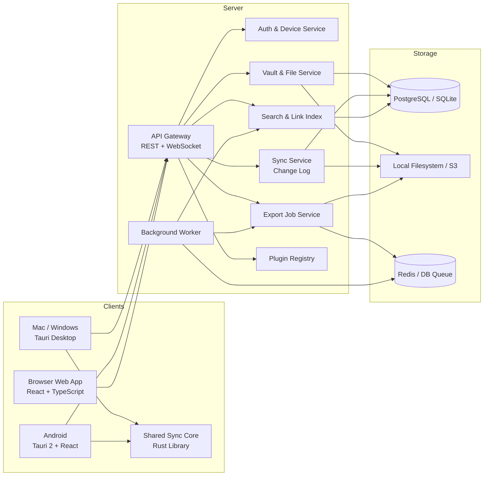
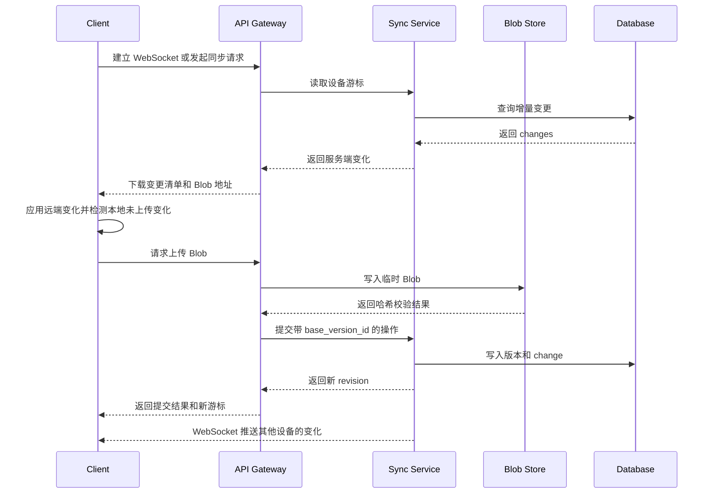
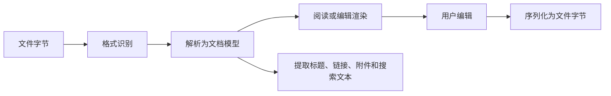

# WeNote 产品与技术设计

> 文档状态：设计初稿
> 更新时间：2026-11-20
> 目标：从零设计一个参考 Obsidian 与 Typora 的多端 Markdown 笔记系统，提供本地文件同步、服务端网页编辑、附件存储、插件化文档格式和思维导图能力。

## 1. 产品定位

WeNote 是一个以文件为中心的多端笔记系统。用户的笔记以 Markdown 等普通文件存在本地目录中，客户端负责编辑和同步，服务端负责账户、Vault、版本、搜索、网页访问、附件存储、导出和设备管理。

系统需要同时满足三个目标。

1. 本地文件始终可直接读取和备份。
2. 多台设备可以离线编辑并在恢复网络后同步。
3. 服务端网页可以展示和修改同一套笔记内容。

核心设计原则如下。

- 文件内容是可迁移资产，不能依赖数据库才能读取。
- 同步建立在文件版本和操作日志之上，客户端可以离线工作。
- Markdown、JSON、TXT、XMind 等格式由文档插件负责解析、渲染和保存。
- 笔记正文和图片、音频、视频、PDF 等附件使用相同的文件树模型，使用不同的存储和导出策略。
- 个人使用可以单机部署，团队使用可以切换到 PostgreSQL、S3 和多实例服务端。
- 初期优先保证同步正确、数据可恢复和文件兼容，实时协作不纳入当前产品范围。

## 2. 参考范围与设计结论

本设计参考以下产品和项目的公开能力模型。

- Obsidian 的本地 Vault、Markdown 文件、双向链接、标签、图谱和插件思路。
- Typora 的 Markdown 所见即所得编辑体验。
- `fast-note-sync-service` 的 Vault 同步、历史版本、回收站、离线合并、Web 管理、S3 兼容存储和分片上传思路。
- CommonMark、GitHub Flavored Markdown、Mermaid、KaTeX、CodeMirror 6 等成熟解析和编辑组件。

参考项目地址为 [fast-note-sync-service](https://github.com/haierkeys/fast-note-sync-service)。具体协议和实现不直接复制，WeNote 会使用自己的文件身份、版本、操作日志和插件接口。

## 3. 用户与使用场景

### 3.1 个人用户

用户在 Mac 或 Windows 上维护一个或多个 Vault，使用本地目录读写 Markdown 文件。在 Android 上查看和编辑同一套笔记，设备离线时也可以继续工作。恢复网络后，客户端自动上传本地变化并拉取其他设备的变化。

### 3.2 网页用户

用户在浏览器中登录服务端，查看文件树、搜索内容、编辑 Markdown、上传附件、查看版本历史和导出文件。网页编辑产生的变化需要进入同一条同步流水线，桌面端和移动端可以正常收到。

### 3.3 多设备用户

用户可能同时打开 Mac、Windows、Android 和网页。设备之间会出现离线编辑、文件重命名、文件移动、附件上传、删除和恢复等操作。系统需要保持可追踪、可重试和可恢复。

### 3.4 插件开发者

插件开发者可以为一种文件格式提供文件识别、解析、渲染、编辑、保存、导入、导出、目录提取和链接提取能力。Markdown 插件属于内置插件，JSON、TXT、XMind 可以作为内置或扩展插件。

## 4. 产品范围

### 4.1 核心版本范围

- 多账户登录、设备管理和账户隔离。
- Vault 创建、删除、归档和基础权限模型。
- 账户之间分享笔记、目录和附件，并由接收者确认导入。
- Markdown 图片和附件统一使用稳定的 HTTPS Asset URL。
- Mac、Windows 桌面客户端。
- 服务端网页。
- Markdown 和 TXT 文件的查看、编辑和同步。
- Markdown 常用语法和基础阅读预览。
- 本地目录同步到服务端。
- 本地 Blob 和 S3 Blob 存储适配器，Local FS 作为默认实现。
- 服务端同步到多个设备。
- 文件新增、修改、重命名、移动、删除和恢复。
- 图片和普通附件同步。
- 文件版本历史和回收站。
- 笔记文件和附件分开导出。
- 文件名、正文和 Markdown 标题搜索。
- 基于 Markdown 标题生成的基础思维导图视图。

### 4.2 增强版本范围

- Android 客户端。
- JSON 插件和结构化编辑。
- `.xmind` 插件。
- Markdown 与思维导图的相互导入和导出。
- 笔记关系图谱、标签、属性、反向链接和全文搜索增强。
- Typora 风格实时预览。
- 模板、每日笔记、命令面板和快捷键管理。
- PDF、HTML、纯文本和 Markdown 导出。
- 断点续传、上传任务中心和大附件优化。
- 分享链接、密码、有效期和分享记录管理。
- 账户间分享的来源追踪和手动更新副本。
- 插件市场或私有插件仓库。

### 4.3 后续阶段增加

- 端到端加密 Vault。
- OCR、语音转文字和附件内容索引。
- 数据库视图、看板和自定义块。
- 跨 Vault 搜索和统一引用。

## 5. 总体架构

### 5.1 架构图



### 5.2 组件职责

| 组件 | 主要职责 | 推荐实现 |
| --- | --- | --- |
| 桌面客户端 | 本地目录、编辑器、文件监听、同步状态、插件运行 | Tauri 2、React、TypeScript、Rust |
| Android 客户端 | 移动端文件缓存、编辑、同步、附件和分享 | Tauri 2、React、TypeScript、Rust，Android 特有能力使用 Kotlin 插件 |
| 网页端 | 文件树、搜索、编辑、预览、历史、导出、管理 | React、TypeScript、CodeMirror 6 |
| 共享同步核心 | 文件扫描、哈希、操作队列、冲突检测、合并 | Rust，使用 UniFFI 或 Wasm 暴露接口 |
| API 服务 | 认证、Vault、文件、同步、导出和插件接口 | Go |
| 数据库 | 元数据、版本、操作日志、索引、任务状态 | SQLite 或 PostgreSQL |
| Blob 存储 | 正文、图片、附件、导出包 | Local FS、S3、MinIO |
| 后台 Worker | 索引、预览、导出、清理和重试 | Go Worker |

### 5.3 为什么桌面端和 Android 都使用 Tauri

Tauri 2 可以构建桌面和移动应用，前端可以使用同一套 HTML、JavaScript 和 CSS，底层逻辑可以使用 Rust。Tauri 插件也允许为 Android 增加 Kotlin 或 Java 实现。因此 WeNote 可以使用一个 Tauri 2 客户端项目，同时构建 Mac、Windows 和 Android 版本。

共享部分包括编辑器 UI、Markdown 插件、同步协议、Rust 同步核心、账户逻辑和大部分状态管理。平台差异通过 Tauri capability、插件和少量响应式 UI 处理。

Android 需要单独处理文件访问。Tauri 文件系统插件在 Android 上默认限制在应用目录，访问用户选择的外部目录、公共文档目录或下载目录时需要 Android 权限和系统文件选择器。对于 WeNote，建议 Android 默认把 Vault 缓存在应用目录中，提供“导入目录”或“选择同步目录”时再接入 Storage Access Framework。桌面端继续支持用户直接选择任意本地目录。

Android 的后台同步、通知、分享、文件选择和电池策略也需要移动端插件或原生配置。同步核心可以保持 Rust 共享，后台任务的调度由 Android 平台实现。

### 5.4 为什么拆分同步核心

同步同时涉及本地文件系统、数据库、网络重试、内容哈希、冲突处理和平台差异。把这些规则放到一个共享核心中，可以让 Mac、Windows 和 Android 使用相同的文件身份和同步状态模型。

网页端直接使用服务端接口。网页端的编辑操作由服务端生成标准变更事件，和客户端上传的变更使用相同的数据结构。

## 6. 仓库与项目结构

建议采用单仓库结构，方便共享协议、插件接口和测试夹具。

```text
we-note/
├── apps/
│   ├── client/                  # 一个 Tauri 2 项目，构建 Mac、Windows 和 Android
│   └── web/                     # 服务端网页
├── crates/
│   ├── sync-core/               # Rust 同步核心
│   ├── document-core/           # 文档抽象和插件运行时
│   └── protocol/                # 同步协议和数据模型
├── plugins/
│   ├── markdown/                # Markdown 内置插件
│   ├── text/                    # TXT 插件
│   ├── json/                    # JSON 插件
│   └── xmind/                   # XMind 插件
├── services/
│   ├── api/                     # Go API 服务
│   ├── worker/                  # Go 后台任务
│   └── migrations/              # 数据库迁移
├── packages/
│   ├── protocol-ts/             # Web 使用的协议类型
│   ├── editor-ui/               # Web 和桌面共享 UI
│   └── plugin-sdk/              # 插件 SDK
├── docs/
├── deploy/
│   ├── docker-compose.yml
│   ├── docker-compose.s3.yml
│   └── kubernetes/
└── tests/
    ├── sync-fixtures/
    ├── protocol/
    └── e2e/
```

## 7. 核心数据模型

### 7.1 逻辑对象

系统中最重要的对象是 User、Vault、File、Asset、Blob、File Version、Change、Device、Share 和 Export Job。

- User 是服务端账户，账户之间默认隔离。
- Vault 是用户的一套笔记空间，类似一个本地笔记目录。
- File 是 Vault 中的逻辑文件，使用稳定的 `file_id` 标识。
- Asset 是图片和附件的逻辑对象，使用稳定的 `asset_id` 标识。
- Blob 是文件内容的实际二进制对象，可以由本地文件系统或 S3 保存。
- File Version 是某个文件在某个时间点的完整内容版本。
- Change 是对文件或目录的一个不可变变更事件。
- Device 是一个客户端实例，具有独立的设备 ID 和同步游标。
- Share 是发送者创建的文件快照分享对象。
- Export Job 是服务端生成下载包的异步任务。

### 7.2 文件模型

```text
File
├── file_id             稳定 UUID 或 ULID
├── vault_id            所属 Vault
├── parent_id           父目录逻辑 ID，可为空
├── path                规范化相对路径
├── path_key            用于冲突判断的规范化路径键
├── display_name        文件或目录名称
├── kind                file、directory、symlink-disabled
├── format              md、txt、json、xmind、binary、unknown
├── current_version_id  当前文件版本，可为空
├── is_deleted          软删除标记
├── created_at          创建时间
├── updated_at          最后更新时间
└── updated_by          产生最后变更的设备或网页会话

FileVersion
├── version_id          稳定 UUID 或 ULID
├── file_id             所属 File
├── vault_revision      生成该版本的 Vault revision
├── blob_id             内容 Blob
├── content_hash        完整文件内容 SHA-256
├── semantic_hash       可选的解析后语义哈希
├── size                字节数
├── base_version_id     产生该版本时的父版本
├── created_at
└── created_by
```

路径是用户看到的名称，`file_id` 是同步和历史版本使用的稳定身份。重命名和移动操作保持 `file_id` 不变，因此可以保留链接关系和历史版本。

### 7.3 推荐数据库表

| 表 | 作用 |
| --- | --- |
| `users` | 用户账户和认证信息 |
| `workspaces` | Vault 基本信息、配额、存储配置 |
| `workspace_members` | Vault 成员和角色 |
| `devices` | 设备信息、密钥、公钥、最后同步时间 |
| `files` | 文件和目录的当前状态 |
| `file_versions` | 文件历史版本和内容引用 |
| `blobs` | Blob 哈希、大小、存储后端和引用计数 |
| `changes` | Vault 级别的有序变更日志 |
| `sync_cursors` | 设备在每个 Vault 上的同步游标 |
| `conflicts` | 冲突记录、解决状态和关联文件 |
| `note_index` | 标题、标签、属性、正文搜索索引 |
| `note_links` | Wiki Link、Markdown Link、嵌入关系 |
| `export_jobs` | 导出任务、过滤条件、进度和结果 |
| `plugin_packages` | 插件包、版本、兼容性和来源 |
| `assets` | 图片和附件的逻辑对象 |
| `file_asset_refs` | Markdown 文件与 Asset 的引用关系 |
| `upload_sessions` | 分片上传和临时上传状态 |
| `shares` | 分享快照、分享链接、权限、有效期和状态 |
| `share_items` | 分享中包含的文件、目录和 Asset |
| `share_acceptances` | 接收者、目标 Vault、导入结果和更新时间 |
| `outbox_events` | 事务提交后的通知、索引和异步任务事件 |
| `audit_logs` | 登录、分享、删除、导出和权限变更 |

### 7.4 数据库与 Blob 的边界

数据库保存元数据和索引，Blob 存储保存文件正文和附件二进制内容。数据库中的 `content_hash` 和 Blob 的校验值必须一致。服务端收到文件后先校验哈希，再写入当前版本和变更日志。

本地存储使用类似下面的逻辑布局。具体目录可以由部署配置决定。

```text
storage/
├── blobs/
│   └── <vault-id>/
│       └── <YYYY>/<MM>/<DD>/<sha256>
├── exports/
│   └── <job-id>.zip
├── previews/
│   └── <blob-hash>/<preview-type>
└── trash/
    └── <vault-id>/<file-id>/<version-id>
```

S3 使用等价的 object key。文件的用户路径存放在数据库中，避免用户重命名导致 S3 对象大规模移动。FileVersion 和 Asset 通过 `blob_id` 引用 Blob，文件历史版本不依赖当前路径或当前对象键。

## 8. 本地 Vault 设计

### 8.1 本地目录

用户选择一个目录作为 Vault 根目录。笔记正文、图片和附件都以普通文件存在。客户端在根目录旁或用户配置目录中保存同步状态，默认不污染用户笔记目录。

推荐使用以下本地状态目录。

```text
<user-config>/WeNote/vaults/<vault-id>/
├── state.db                 # 文件映射、版本、操作队列、冲突状态
├── cache/                   # 下载缓存和预览缓存
├── logs/                    # 同步诊断日志
└── lock                    # 客户端实例锁
```

如果用户希望把同步状态放入 Vault，提供高级设置将其放入 `.wenote/`，并在同步规则中排除该目录。

### 8.2 文件扫描与监听

客户端同时使用文件系统监听和定期扫描。

1. 启动时扫描目录并建立文件清单。
2. 监听新增、修改、重命名、移动和删除事件。
3. 对短时间内重复事件进行合并和去抖。
4. 读取文件并计算内容哈希。
5. 和本地状态中的 `file_id`、路径、哈希比较。
6. 生成本地操作队列。
7. 同步成功后写入新的游标和文件版本。

文件系统监听不能作为唯一来源，因为不同操作系统对批量移动、休眠唤醒和网络磁盘的事件行为不同。每次启动和定期后台任务都需要做一次增量扫描。

### 8.3 文件编码与路径

- 文件内容按二进制保存，Markdown 等文本格式默认按 UTF-8 解析。
- 保留 BOM 和原始换行风格信息，解析器内部可以使用 LF。
- 保存文件时尽量维持现有换行风格。
- 服务端路径使用 `/` 分隔。
- 禁止 `..`、NUL、绝对路径和符号链接逃逸。
- Windows 下对大小写不敏感的路径冲突需要被识别并提示。
- 同一 Vault 中不允许两个规范化路径相同的活跃文件。
- Unicode 名称采用统一规范处理，同时保留用户显示名称。

## 9. 同步设计

### 9.1 同步目标

同步的目标是让同一个 Vault 在多台设备和网页端最终收敛到一致状态，同时保存所有无法自动合并的冲突信息。

同步需要具备以下特性。

- 支持离线编辑。
- 支持断线重试。
- 支持幂等上传。
- 支持文件级别的新增、修改、移动、重命名和删除。
- 支持文本冲突合并。
- 支持二进制文件冲突保留。
- 支持大附件分片上传。
- 支持服务端推送变更通知。
- 支持从任意快照恢复。
- 支持客户端从服务端重新构建本地状态。

### 9.2 同步模型

每个 Vault 有一个单调递增的 `vault_revision`。服务端在数据库事务中为每个有效变更分配一个 revision，并写入不可变 `changes` 表。`vault_revision` 只用于增量拉取和恢复游标，不直接决定单个文件是否发生冲突。分配 revision 时需要锁定 Vault 的 revision 行，保证多实例服务端不会产生重复序号。

文件冲突使用 `base_version_id` 或 `base_content_hash` 做条件判断。服务端只有在当前文件版本仍然等于客户端基准版本时，才可以直接提交新的内容版本。其他 Vault 文件发生变化不会阻塞当前文件上传。

Change Log 需要保留 `min_available_revision`。当旧日志被压缩后，游标早于该值的客户端必须下载新的 manifest 快照，再从快照 revision 继续同步。

客户端为每个 Vault 保存以下状态。

```text
SyncState
├── vault_id
├── device_id
├── last_server_revision
├── last_manifest_hash
├── pending_operations
├── local_file_map
├── conflict_records
└── last_success_at
```

客户端同步时携带 `last_server_revision`。服务端返回该 revision 之后的变更。如果游标过旧、日志已归档或客户端状态校验失败，服务端返回快照清单，客户端重新建立映射。

### 9.3 变更类型

```text
create_file
update_file_content
rename_file
move_file
delete_file
restore_file
create_directory
rename_directory
move_directory
delete_directory
restore_directory
set_file_metadata
```

目录操作可以由服务端展开为目录和子文件变化，也可以作为目录元数据事件保留。推荐在协议中保留目录操作，服务端在同一事务中更新目录及其后代文件的规范化路径。若目标路径已经被其他 File 占用，服务端返回路径冲突，客户端进入重命名或合并流程。

### 9.4 变更请求

客户端上传的每条变更包含以下信息。

```json
{
  "operation_id": "op_01J...",
  "device_id": "device_01J...",
  "vault_id": "vault_01J...",
  "base_revision": 182,
  "base_version_id": "ver_01J...",
  "base_content_hash": "sha256:...",
  "file_id": "file_01J...",
  "operation": "update_file_content",
  "path": "projects/roadmap.md",
  "content_hash": "sha256:...",
  "content_size": 8231,
  "blob_reference": "upload_01J...",
  "client_timestamp": "2026-11-20T10:30:00Z",
  "metadata": {
    "format": "md",
    "line_ending": "lf"
  }
}
```

`operation_id` 是幂等键。服务端重复收到同一操作时返回第一次处理结果，不重复写入 Blob、版本和变更事件。`base_revision` 是客户端已经应用到本地的 Vault 游标，`base_version_id` 是当前文件的并发控制条件。

### 9.5 同步流程



WebSocket 通知采用至少一次投递语义。客户端按照 `change_id` 或 `vault_revision` 去重，通知丢失时继续通过 HTTP 增量拉取恢复。

### 9.6 文本冲突策略

Markdown、TXT 和 JSON 属于可合并文本，冲突时使用三方合并。

- `base` 是客户端上次确认的版本。
- `local` 是客户端当前未上传的内容。
- `remote` 是服务端在该文件上的最新版本。
- 无重叠修改时自动合并。
- 有重叠修改时生成冲突文件或冲突标记，并把冲突记录写入服务端。

默认行为如下。

```text
projects/roadmap.md
projects/roadmap (conflict from Windows).md
```

同时在客户端提供三栏合并界面。用户可以选择本地版本、远端版本或编辑合并结果。解决结果会生成新的普通文件版本，并关闭冲突记录。

对于 JSON，优先尝试按结构合并。结构无法解析或数组存在重叠修改时退回文本合并。

对于 XMind、图片、音频、视频、PDF 和其他二进制文件，无法安全自动合并。冲突时保留两个版本，并在文件名或冲突面板中提示用户。

### 9.7 删除与回收站

删除是带有 `deleted_at` 的软删除操作。服务端保留删除前的版本和 Blob 引用。客户端收到删除事件时将本地文件移动到客户端回收站或标记为远端删除，避免直接丢失用户未同步的内容。

恢复操作使用原始 `file_id` 和新的 revision。服务端回收站可以按 Vault 配置保留 30 天、90 天或永久保留。

### 9.8 大文件和分片上传

大于配置阈值的文件使用分片上传。

1. 客户端请求上传会话。
2. 服务端返回 upload ID、分片大小和已完成分片列表。
3. 客户端并行上传缺失分片。
4. 客户端提交完成请求并携带整体 SHA-256。
5. 服务端合并分片并校验整体哈希。
6. 客户端提交文件变更操作。

上传会话可以断点续传。每个分片请求需要带 `Content-Range`、分片序号和分片哈希。上传会话需要关联 `operation_id`、Asset 或 File，并设置过期时间。完成接口必须幂等，服务端重启后可以根据已保存的分片状态继续处理。

### 9.9 WebSocket 与 HTTP 的分工

- WebSocket 负责在线状态、变更通知和同步唤醒。
- HTTP 负责快照、文件清单、Blob 上传下载、导出和历史查询。
- WebSocket 断开后，客户端回退到定时 HTTP 同步。

第一版不实现多人同时编辑、字符级实时协作和光标同步。网页编辑、桌面端编辑和 Android 编辑都通过普通文件版本和同步变更完成。

## 10. 服务端 API 设计

API 版本使用 `/api/v1` 前缀。返回值统一包含请求 ID，错误返回稳定的错误码和可读消息。所有创建操作和会改变状态的请求都支持 `Idempotency-Key`，上传完成、分享接受和导出创建尤其需要幂等。

### 10.1 认证

```text
POST   /api/v1/auth/register
POST   /api/v1/auth/login
POST   /api/v1/auth/refresh
POST   /api/v1/auth/logout
GET    /api/v1/me
GET    /api/v1/devices
DELETE /api/v1/devices/{device_id}
```

推荐使用短期 access token 和可撤销 refresh token。设备注册时生成设备 ID，并在服务端保存设备公钥和客户端版本。

### 10.2 Vault

```text
GET    /api/v1/vaults
POST   /api/v1/vaults
GET    /api/v1/vaults/{vault_id}
PATCH  /api/v1/vaults/{vault_id}
DELETE /api/v1/vaults/{vault_id}
GET    /api/v1/vaults/{vault_id}/members
POST   /api/v1/vaults/{vault_id}/members
PATCH  /api/v1/vaults/{vault_id}/members/{user_id}
DELETE /api/v1/vaults/{vault_id}/members/{user_id}
```

成员接口为共享 Vault 预留。核心版本只允许 Vault 所有者直接修改，账户间访问通过 Share 接口处理。

### 10.3 文件和目录

```text
GET    /api/v1/vaults/{vault_id}/files
POST   /api/v1/vaults/{vault_id}/files
GET    /api/v1/vaults/{vault_id}/files/{file_id}
GET    /api/v1/vaults/{vault_id}/files/{file_id}/content
PUT    /api/v1/vaults/{vault_id}/files/{file_id}/content
PATCH  /api/v1/vaults/{vault_id}/files/{file_id}
DELETE /api/v1/vaults/{vault_id}/files/{file_id}
POST   /api/v1/vaults/{vault_id}/files/{file_id}/restore
GET    /api/v1/vaults/{vault_id}/files/{file_id}/versions
GET    /api/v1/vaults/{vault_id}/files/{file_id}/versions/{version_id}
```

`PUT content` 必须携带 `base_version_id` 或 `base_content_hash`。服务端使用当前 FileVersion 做条件更新，并在版本不匹配时返回冲突信息。

### 10.4 同步

```text
GET    /api/v1/vaults/{vault_id}/sync/manifest
POST   /api/v1/vaults/{vault_id}/sync/changes
POST   /api/v1/vaults/{vault_id}/sync/upload-sessions
GET    /api/v1/vaults/{vault_id}/sync/upload-sessions/{upload_id}
POST   /api/v1/vaults/{vault_id}/sync/upload-sessions/{upload_id}/complete
GET    /api/v1/vaults/{vault_id}/sync/ws
```

### 10.5 Asset

```text
POST   /api/v1/vaults/{vault_id}/assets/uploads
GET    /api/v1/vaults/{vault_id}/assets/{asset_id}
POST   /api/v1/vaults/{vault_id}/assets/{asset_id}/complete
DELETE /api/v1/vaults/{vault_id}/assets/{asset_id}
GET    /assets/{year}/{month}/{day}/{sha256}
GET    /assets/{asset_id}  # 兼容旧 URL
```

在线提交时，服务端需要在接受正式 Markdown 版本前确认引用的 Asset 已完成，或者把 Asset 作为同一批带依赖关系的操作提交。离线客户端可以先把 Markdown 和未完成 Asset 放入本地队列，服务端最终落库时仍然需要保证 Asset 完成状态、Blob 引用和正文版本之间可以被重试和恢复。

### 10.6 搜索和关系

```text
GET /api/v1/vaults/{vault_id}/search?q=...
GET /api/v1/vaults/{vault_id}/tags
GET /api/v1/vaults/{vault_id}/links/backlinks?file_id=...
GET /api/v1/vaults/{vault_id}/graph
GET /api/v1/vaults/{vault_id}/outline?file_id=...
```

### 10.7 导出

```text
POST /api/v1/vaults/{vault_id}/exports
GET  /api/v1/vaults/{vault_id}/exports
GET  /api/v1/vaults/{vault_id}/exports/{job_id}
GET  /api/v1/vaults/{vault_id}/exports/{job_id}/download
DELETE /api/v1/vaults/{vault_id}/exports/{job_id}
```

### 10.8 文件分享

```text
POST   /api/v1/shares
GET    /api/v1/shares/sent
GET    /api/v1/shares/inbox
GET    /api/v1/shares/{share_id}
POST   /api/v1/shares/{share_id}/accept
POST   /api/v1/shares/{share_id}/reject
DELETE /api/v1/shares/{share_id}
GET    /s/{share_token}
GET    /s/assets/{asset_id}
```

创建分享时提交文件或目录列表、接收账户或分享链接、权限、有效期和是否允许下载。接收者确认后选择目标 Vault 和目标目录，服务端复制文件快照以及关联 Asset，并把 Markdown 中的 Asset URL 改写为接收方 Asset 的 HTTPS 地址。分享快照需要记录依赖闭包，目录中 Markdown 引用到的 Asset 即使位于其他目录，也要被纳入分享或明确标记为外部资源。

分享链接查看页面打开后，服务端应把长期分享令牌交换为短期的 HttpOnly 分享会话或短期 Asset 授权。页面通过分享会话访问 `/s/assets/{asset_id}`，避免把长期令牌重复放入每个图片 URL。分享令牌撤销、过期或达到限制后，笔记页面和 Asset 地址都应立即失效。

导出请求示例。

```json
{
  "scope": "notes",
  "include_deleted": false,
  "paths": ["projects/", "daily/"],
  "include_manifest": true,
  "format": "zip"
}
```

`scope` 支持以下值。

- `notes` 只导出 Markdown、TXT、JSON、XMind 等文档文件。
- `assets` 只导出图片、音频、视频、PDF 和其他附件。
- `all` 导出整个 Vault。
- `selected` 按用户选择的路径导出。

导出包建议附带 `manifest.json`，记录文件路径、内容哈希、原始文件 ID、版本和导出时间。

## 11. 存储设计

### 11.1 本地存储

适合个人部署和开发环境。Blob 由服务端写入指定目录，数据库记录相对存储键。服务端需要在同一文件系统上使用临时目录和原子 rename，避免服务进程中断产生半文件。

### 11.2 S3 兼容存储

支持 AWS S3、MinIO、Cloudflare R2 和其他 S3 兼容服务。通过存储适配器抽象以下操作。Markdown 中仍然使用 WeNote 的稳定 HTTPS Asset URL，存储后端切换不需要重写正文。

```text
PutObject
GetObject
HeadObject
DeleteObject
CreateMultipartUpload
UploadPart
CompleteMultipartUpload
AbortMultipartUpload
PresignGet
PresignPut
```

服务端不把 S3 URL 或短期预签名 URL 直接写入 Markdown。网页端和客户端通过 WeNote 资源网关读取 Asset，网关可以重定向到 S3 或由服务端代理读取。

### 11.3 存储配置

存储配置默认属于服务器实例，所有 Vault 共用同一个 `public_base_url`。未来如有需要，再增加单个 Vault 的存储覆盖配置。配置至少包含以下字段。

```text
backend: local | s3
local_root
s3_endpoint
s3_region
s3_bucket
s3_prefix
s3_access_key_ref
s3_secret_key_ref
multipart_threshold
quota_bytes
public_base_url
asset_access_mode: private | public
cdn_base_url
```

密钥只存储在服务端密钥管理配置中，管理页面只显示脱敏结果。

## 12. 图片与附件 URL 设计

### 12.1 核心原则

Markdown 中保存的是稳定的 HTTPS 逻辑地址，图片和附件实际保存在哪里由服务端存储适配器决定。推荐的地址形式如下。

```text
https://notes.example.com/assets/YYYY/MM/DD/{sha256}
```

例如：

```markdown

```

canonical URL 使用附件创建日期和内容哈希，不包含文件名，因此附件重命名不会改变 Markdown 中的地址。服务端通过 `Content-Type` 和 `Content-Disposition` 提供文件类型和下载名称。如果图片内容被替换，创建新的 Asset 和新的 URL，避免浏览器和 CDN 缓存旧内容。数据库继续使用 Asset ID 关联权限和历史记录，旧的 `/assets/{asset_id}` URL 继续兼容。

这个 HTTPS 地址是 WeNote 的资源网关地址，不等同于本地磁盘路径，也不等同于某一个 S3 预签名地址。服务端根据日期、内容哈希和数据库中的 Asset 记录查询权限、Blob 和存储后端，再决定从本地文件、S3、MinIO 或 CDN 返回内容。

### 12.2 本地文件存储

本地存储需要提供图片和附件访问接口，但不需要单独部署一个独立图床产品。API 服务本身就可以提供资源网关。

```text
GET /assets/{year}/{month}/{day}/{sha256}
```

请求流程如下。

1. 服务端根据 `asset_id` 查询 Asset 元数据。
2. 检查用户、Vault 或公开分享权限。
3. 从本地 Blob 目录读取文件。
4. 返回正确的 `Content-Type`、`Content-Length`、`ETag` 和缓存头。
5. 对大文件使用 Range 响应。

部署在 Nginx 或 Caddy 后面时，可以由 API 服务完成鉴权，再使用内部转发或 `X-Accel-Redirect`、`X-Sendfile` 交给 Web 服务器发送文件，减少 Go 进程占用。

因此，本地存储对应的是“服务端资源访问接口”，可以理解为 WeNote 内置图床能力。Markdown 只引用 HTTPS 地址，不引用服务器磁盘路径。

### 12.3 S3 和 MinIO 存储

S3 模式推荐使用私有 Bucket。上传过程可以使用服务端生成的短期 PUT 预签名 URL，正文中的图片链接仍然使用 WeNote 的稳定 HTTPS 地址。

```text
Markdown URL
  -> https://notes.example.com/assets/ast_01JABC123
  -> WeNote 资源网关鉴权
  -> 查询 S3 object key
  -> 302 到短期 GET 预签名 URL，或由服务端流式转发
  -> S3 / MinIO 返回对象
```

预签名 URL 适合上传和短期下载授权。它具有明确的过期时间，不能直接写入 Markdown，否则笔记中的图片会在 URL 过期后失效。

如果图片确实允许公开访问，可以使用独立的 CDN 域名，例如 `https://cdn.example.com/assets/YYYY/MM/DD/{sha256}`。这时 S3 Bucket 仍建议保持私有，由 CDN 的 Origin Access Control 访问 S3，并通过 CDN 为 S3 内容提供 HTTPS 和受控访问。

直接把 AWS S3 对象地址写入 Markdown 只适合明确接受以下约束的公开资源场景。

- Bucket 或对象需要对外公开。
- Markdown 会绑定到具体的 AWS 区域、Bucket 和对象 URL。
- 后续迁移到 MinIO、其他 S3 服务或新的域名时需要批量改写链接。
- 访问控制、分享撤销和统一审计会比较困难。

WeNote 的规范模式仍然是使用自己的 HTTPS 资源 URL，把 S3 当作后端 Blob 存储。

### 12.4 Asset 数据模型

```text
Asset
├── asset_id
├── vault_id
├── file_id                对应 Vault 中的附件 File
├── current_version_id
├── original_name
├── display_name
├── mime_type
├── size
├── content_hash
├── storage_backend       local | s3
├── storage_key
├── canonical_url
├── access_mode           private | public
├── status                pending | ready | deleted
├── width
├── height
├── created_by
├── created_at
└── deleted_at
```

正文文件和 Asset 分开保存。Markdown 文件中只保存 `canonical_url`，服务端通过解析正文建立 `file_asset_refs` 引用表。

### 12.5 上传和插入流程

用户粘贴图片或拖入附件时，客户端执行以下流程。

1. 客户端生成稳定的 `asset_id` 和本地临时 Asset，并计算内容哈希。
2. 客户端根据 Vault 的 `public_base_url` 生成 `canonical_url`，即使离线也可以把 URL 写入 Markdown。
3. 客户端创建 Asset 上传任务，在线时向服务端申请上传会话。
4. 客户端把文件上传到本地接口或 S3 预签名地址。
5. 服务端校验大小、MIME 和 SHA-256，并完成 Asset。
6. 编辑器把 `canonical_url` 写入 Markdown。
7. 同步引擎先提交 Asset，再提交引用该 Asset 的 Markdown 版本，或者等待 Asset 上传任务完成。
8. 服务端异步解析正文并更新 `file_asset_refs`。

失败的上传会话可以重试和清理。离线期间 Markdown 可以引用尚未上传完成的 Asset，客户端需要在同步队列中维护 Asset 到正文版本的依赖关系。

### 12.6 客户端离线显示

Markdown 中保留 HTTPS URL，同时客户端维护 `asset_id` 到本地缓存文件的映射。Markdown 插件识别 WeNote 资源 URL 后按以下顺序渲染。

1. 本地缓存存在且哈希匹配时，使用本地缓存生成对象 URL。
2. 本地没有缓存且网络可用时，使用资源网关下载并写入缓存。
3. 网络不可用且本地没有缓存时，显示资源未下载提示。

这样可以满足 Markdown 内部使用 HTTPS 地址，同时保留移动端和桌面端的离线阅读能力。原始 Markdown 文件在外部编辑器中打开时，仍然按照普通 HTTPS 图片链接处理。服务端地址发生变化时，使用导出迁移工具或资源网关重定向处理历史 URL。

### 12.7 访问模式和缓存

默认 Asset 使用私有访问。网页端使用同源 Cookie 或资源网关生成的短期访问授权，桌面端和 Android 使用客户端凭据下载并缓存。公共分享使用独立的分享令牌或公开 Asset URL，不能复用普通登录会话。

Asset 上传后默认不可变，使用内容哈希和稳定 `asset_id` 做缓存控制。私有资源使用私有缓存策略，公开资源可以使用较长的 `Cache-Control`。SVG、HTML 和可执行格式需要单独处理，避免把不受信任的内容直接作为网页脚本执行。

## 13. Markdown 文档系统

### 13.1 Markdown 兼容范围

Markdown 内置插件第一版支持以下能力。

- CommonMark 基础语法。
- GFM 表格、任务列表、删除线和自动链接。
- YAML Front Matter。
- 标题、目录和折叠大纲。
- 图片、附件和 HTTPS Asset URL。
- Wiki Link，例如 `[[目标笔记]]`。
- 标签，例如 `#project`。
- 脚注、引用、分隔线和定义列表扩展。
- 代码块和语法高亮。
- 数学公式和 KaTeX。
- Mermaid 流程图、时序图和思维导图。
- Callout 或 Admonition。
- HTML 片段的受控渲染。
- 块引用和块 ID 的预留。

插件解析器必须保留未知语法的原始文本，防止保存时破坏用户内容。

### 13.2 编辑模式

提供三种模式。

1. 源码模式。使用 CodeMirror 6 直接编辑原始 Markdown。
2. 实时预览模式。编辑光标附近的 Markdown，其他内容渲染成排版结果。
3. 阅读模式。完整渲染，支持目录、链接、图片、代码、公式和 Mermaid。

Typora 风格的实时预览需要将 Markdown AST 和文本位置映射到编辑器视图。第一阶段可以先实现源码和阅读模式，再实现稳定的实时预览，以降低保存时格式变化的风险。

### 13.3 编辑功能

- 自动保存和手动保存。
- 撤销和重做。
- 多标签页。
- 左右或上下分栏。
- 查找、替换和正则搜索。
- 快速打开和命令面板。
- 自动补全链接、标签、文件路径和 Markdown 语法。
- 图片粘贴、拖放和附件上传。
- 目录导航和标题折叠。
- 代码块语言识别和复制。
- 表格插入和调整。
- 任务列表勾选。
- 数学公式预览。
- Mermaid 图表预览。
- 打印和 PDF 导出。
- 快捷键自定义。
- 自动恢复未保存草稿。

### 13.4 文件链接与资源链接

WeNote 内部图片和附件使用稳定的 HTTPS Asset URL。笔记之间的 Wiki Link 和普通文档链接仍然可以使用文件语义，由索引解析到 `file_id`。外部图片 URL 保留原始地址，不纳入 WeNote Asset，除非用户主动导入。

附件粘贴流程如下。

1. 用户粘贴或拖入图片、文件。
2. 客户端创建 Asset 上传任务。
3. 服务端返回稳定的 HTTPS `canonical_url`。
4. Markdown 插件把 `canonical_url` 写入正文。
5. 同步引擎将附件和正文分别上传。
6. 服务端索引正文中的 Asset 引用。

## 14. 插件系统设计

### 14.1 插件目标

插件负责处理一种或一组文件格式。插件必须可以在不同宿主中运行，并且允许宿主逐步增加能力。



### 14.2 插件包结构

```text
plugin-package.zip
├── manifest.json
├── core.wasm
├── web-ui.js
├── desktop-ui.js
├── android-ui.aar             # 可选
├── styles.css
├── schemas/
├── icons/
└── README.md
```

第一版可以只支持 `core.wasm` 和 Web UI。Android 特有的 UI 适配在插件确实需要原生能力时再加入。服务端执行插件时只允许受控的解析和索引能力，不允许插件直接访问宿主文件系统或网络。

### 14.3 插件清单

```json
{
  "id": "com.wenote.markdown",
  "name": "Markdown",
  "version": "1.0.0",
  "api_version": "1",
  "file_extensions": [".md", ".markdown", ".mdown"],
  "mime_types": ["text/markdown"],
  "capabilities": [
    "parse",
    "render",
    "edit",
    "serialize",
    "outline",
    "links",
    "attachments",
    "export"
  ],
  "entry": {
    "core": "core.wasm",
    "web": "web-ui.js"
  }
}
```

### 14.4 插件接口

逻辑接口建议保持小而稳定。

```text
can_handle(file_name, mime_type, bytes_prefix) -> score
open(document_id, bytes, options) -> document_handle
render(document_handle, render_mode, options) -> render_tree
apply_edit(document_handle, edit) -> edit_result
serialize(document_handle, options) -> bytes
get_outline(document_handle) -> outline
get_links(document_handle) -> links
get_attachments(document_handle) -> attachments
get_search_text(document_handle) -> text
export(document_handle, target_format, options) -> bytes
close(document_handle)
```

`render_tree` 使用宿主定义的安全节点集合，避免插件直接注入任意脚本。需要自定义组件时使用插件声明的 UI 扩展点。

### 14.5 插件安全

插件默认运行在沙箱中。

- 文件访问必须经过宿主授予的能力。
- 网络访问默认关闭。
- 不能直接访问其他 Vault。
- 不能读取用户凭据和同步令牌。
- Web 渲染使用 CSP 和受控 DOM。
- 插件包包含版本、来源和哈希。
- 私有部署可以安装本地插件包。
- 管理员可以限制允许的插件来源。

### 14.6 内置插件

#### Markdown 插件

负责 Markdown 解析、实时预览、目录、链接、标签、属性、公式、Mermaid、图片和附件。

#### TXT 插件

提供纯文本编辑、编码识别、换行保持、查找替换和基础统计。

#### JSON 插件

提供格式化、压缩、语法高亮、结构折叠、JSON Pointer 定位、语法校验和结构化编辑。

#### XMind 插件

提供 `.xmind` 文件识别、节点树编辑、主题样式、关系线、概要、导入和导出。XMind 文件的内部封装和版本兼容需要在实现阶段根据目标 XMind 版本建立测试样本库。

#### Mindmap 插件

提供 Markdown 标题树、Mermaid mindmap 和独立思维导图文档之间的转换。独立思维导图可以使用自有 JSON 模型，按需导出 `.xmind`。

### 14.7 插件和服务端网页

网页端需要知道文件格式对应的渲染和编辑能力。插件有两种部署方式。

- 内置插件随 Web 应用发布。
- 可安装插件由服务端返回清单和版本，网页端下载受信任的插件包。

服务端索引可以使用插件的 `get_search_text`、`get_outline`、`get_links` 和 `get_attachments` 能力。插件不可用时，服务端仍然保留原始文件和基础文件名搜索。

## 15. 思维导图设计

### 15.1 三种来源

- Markdown 标题树。
- Markdown 中的 Mermaid mindmap 代码块。
- 独立 XMind 或 WeNote mindmap 文件。

### 15.2 第一版交互

- 从当前 Markdown 标题生成思维导图。
- 点击节点定位到对应标题。
- 折叠和展开节点。
- 修改节点标题后写回 Markdown 标题。
- 调整节点顺序后重新生成标题层级。
- 导出 PNG、SVG、PDF 和 XMind。
- 从 XMind 导入为 Markdown 标题树。

### 15.3 数据模型

```text
MindmapDocument
├── id
├── title
├── root_node
├── nodes[]
│   ├── node_id
│   ├── parent_id
│   ├── text
│   ├── order
│   ├── style
│   ├── note
│   ├── link
│   └── children[]
├── relationships[]
└── metadata
```

Markdown 双向转换需要保存节点和标题的来源位置。无法表达的颜色、图标和关系线可以存入 Front Matter 或伴随元数据文件，避免破坏普通 Markdown 的可读性。

## 16. 服务端网页设计

### 16.1 页面结构

- 登录和注册。
- Vault 列表。
- Vault 文件树。
- 笔记编辑器。
- 阅读和预览页面。
- 搜索页面。
- 标签和属性视图。
- 反向链接和关系图谱。
- 思维导图页面。
- 版本历史和差异查看。
- 回收站。
- 导出任务中心。
- 设备和同步状态。
- 存储配置。
- 插件管理。
- 账户分享管理。
- 审计日志。

### 16.2 网页编辑器

网页编辑器和桌面端共享 Markdown 编辑器组件以及插件协议。保存采用乐观并发控制。

```text
打开文件
  -> 读取 file_id、version_id、content_hash
编辑
  -> 定时保存草稿到浏览器本地
点击保存或自动保存
  -> 携带 base_version_id
服务端判断版本是否仍为 base
  -> 直接生成新版本，或返回冲突
```

网页端可以使用 WebSocket 接收同一个文件的其他设备变更。第一版收到远端修改时提示用户刷新或打开差异视图，实时协作不在当前产品范围内。

### 16.3 搜索体验

搜索支持以下范围。

- 文件名和路径。
- Markdown 标题。
- 正文全文。
- 标签。
- Front Matter 属性。
- 文件类型。
- 修改时间。
- 引用和反向链接。

个人部署使用 SQLite FTS5 即可。多实例部署使用 PostgreSQL 全文检索或独立搜索服务。搜索索引是派生数据，丢失后可以从文件重新构建。

## 17. 导出与备份

### 17.1 导出类型

- 只导出笔记文件。
- 只导出图片和附件。
- 导出完整 Vault。
- 导出选中的目录或文件。
- 导出指定版本。
- 导出 Markdown 为 HTML、PDF 或纯文本。
- 导出思维导图为 XMind、SVG、PNG 或 PDF。

### 17.2 导出包规范

```text
wenote-export-20261120.zip
├── notes/
│   ├── projects/roadmap.md
│   └── daily/2026-11-20.md
├── assets/
│   └── images/diagram.png
├── manifest.json
└── checksums.sha256
```

为了保持原始路径，实际导出时也可以采用 Vault 根目录布局，不强制增加 `notes/` 和 `assets/` 前缀。导出任务需要在清单中记录选用的布局模式。

### 17.3 HTTPS 图片链接的导出策略

原始 Vault 和在线导出的 Markdown 保留 HTTPS Asset URL。附件单独导出时，同时生成 `asset-manifest.json`，记录 `asset_id`、原始名称、内容哈希和 canonical URL。

完整离线导出可以提供两种模式。在线兼容模式保留原始 HTTPS URL，适合继续使用原 Vault 服务。离线便携模式将 Markdown 副本中的 WeNote Asset URL 重写为导出包内的相对路径，适合在没有服务端的环境中打开。重写只发生在导出副本，不改变 Vault 中的原始 Markdown。

### 17.4 备份策略

服务端提供手动备份和定时备份。备份对象可以是完整 Vault、只包含正文的备份或只包含附件的备份。备份文件本身使用内容哈希和任务 ID 管理，并保留清理策略。

## 18. 权限与安全

### 18.1 权限层级

- 用户级别控制登录和设备。
- Vault 级别控制所有者和访问范围。
- 分享级别控制查看、下载和导入权限。
- 分享链接支持撤销、过期和密码保护。
- 文件级别预留细粒度权限字段。
- API Token 可以限制 Vault、操作和过期时间。

第一版默认只有 Vault 所有者可以直接修改 Vault。分享接收者导入后获得目标 Vault 内文件的正常编辑权限。Owner、Editor、Viewer 和 Exporter 角色保留给未来的共享 Vault 能力。分享链接的查看者不能通过资源 URL 反向访问发送者的其他文件。

### 18.2 多账户与文件分享

同一个服务端支持多个独立账户。每个账户可以拥有多个 Vault，账户之间的数据默认隔离。共享文件通过 Share 对象授权，不需要把两个账户的 Vault 合并成一个可写空间。

分享分为两种形式。

- 账户分享。发送者指定接收账户，接收者在分享收件箱中确认。
- 分享链接。发送者生成带有效期、权限和可选密码的链接，接收者登录后或使用链接令牌查看、下载或导入。

第一版使用文件快照分享。接收者确认后，服务端把笔记、目录和关联图片或附件复制到接收者选择的 Vault，生成新的 `file_id` 和 `asset_id`。复制后的文件由接收者独立编辑，原发送者后续修改不会自动覆盖接收者内容。

接收分享时，服务端会解析 Markdown 中的 WeNote Asset URL，将来源 Asset 复制到接收者的 Asset 存储位置，并把导入副本中的 URL 改写为接收者的 HTTPS URL。外部图片地址可以原样保留。分享链接页面需要通过分享令牌临时解析来源 Asset，不能直接暴露来源 Vault 的登录权限。

分享快照可以保留来源文件 ID、来源版本和分享 ID，方便接收者查看来源和手动请求新的版本。手动更新属于一次新的导入操作，需要通过差异界面处理本地修改和来源修改。

系统不实现多人同时编辑、字符级实时协作和双向共享目录。普通网页编辑仍然会进入文件级同步和版本历史。

### 18.3 安全要求

- 全站使用 HTTPS。
- 密码使用 Argon2id 哈希。
- Refresh Token 只存储哈希值。
- Access Token 设置较短有效期。
- 附件下载使用授权检查和短期签名 URL。
- HTML、SVG、PDF 预览启用内容安全策略。
- Markdown 中的原始 HTML 默认进行过滤或隔离。
- 路径操作必须经过规范化和权限检查。
- 删除、导出、分享、登录和设备变更写入审计日志。
- 上传限制大小、扩展名、MIME 和配额。
- 服务端不信任客户端提供的文件路径、哈希和权限信息。
- 所有 File、Asset、Share 和 Blob 查询都必须先校验当前用户、Vault 所有权或分享会话，不能因为客户端知道对象 ID 就跨 Vault 读取。
- Share 会话只能访问被分享快照中的 FileVersion 和 Asset，不能访问发送者 Vault 的其他内容。

### 18.4 端到端加密的边界

服务端网页需要读取和修改笔记，因此默认工作区采用服务端可读模式。未来可以增加端到端加密 Vault，但该模式会限制服务端全文搜索、服务端网页编辑、服务端 Markdown 渲染和在线导出能力。

端到端加密应作为单独的 Vault 类型设计，不应在普通 Vault 中混入两种密钥语义。

## 19. 可观测性与运维

### 19.1 服务指标

- API 请求量、延迟和错误率。
- WebSocket 在线连接数。
- 同步成功率、失败率和重试次数。
- 每个 Vault 的变更吞吐。
- Blob 上传、下载和失败分片数量。
- 导出任务耗时和失败率。
- 搜索索引延迟。
- 存储空间、配额和孤儿 Blob。
- 活跃设备数。

### 19.2 日志

日志需要带 `request_id`、`user_id`、`vault_id`、`device_id`、`operation_id` 和 `file_id`。文件正文、Access Token、S3 密钥和用户隐私内容不能写入普通日志。

### 19.3 运行方式

单机部署推荐 Docker Compose。

```text
gateway
worker
postgres 或 sqlite
redis，可选
minio 或外部 S3，可选
reverse-proxy
```

个人模式可以使用单个 API 进程、SQLite 和本地存储。多账户规模增大后切换 PostgreSQL、Redis 和 S3，API 和 Worker 可以水平扩展。

## 20. 一致性与故障恢复

### 20.1 服务端写入顺序

一次文件变更需要按以下顺序处理。

1. 校验身份、Vault 权限、路径和内容大小。
2. 校验 Blob 内容哈希。
3. 写入或复用 Blob。
4. 在数据库事务中写入文件版本、文件当前状态、change 和 outbox event。
5. 提交事务。
6. Worker 根据 outbox event 发送 WebSocket 通知，并更新搜索索引和预览。
7. 客户端继续通过 revision 拉取，确保通知丢失时也可以恢复。

如果数据库事务失败，客户端可以使用相同 `operation_id` 重试。Blob 可能已经存在，但由于使用内容哈希，可以安全复用。

### 20.2 孤儿 Blob

Blob 写入成功但数据库事务失败时会留下孤儿 Blob。后台清理任务根据数据库引用计数和保留时间清理孤儿对象。删除文件时不立即删除共享 Blob，等引用计数归零并经过保留期后再清理。

### 20.3 同步恢复

客户端发现本地状态损坏时，可以执行重新同步。

1. 保留本地目录副本。
2. 删除或重建本地 `state.db`。
3. 从服务端下载 manifest。
4. 按 `file_id` 和路径重新建立映射。
5. 对未匹配的本地文件生成待上传项。
6. 用户确认后继续同步。

服务端也支持从某个 Vault 快照重建文件表和索引。

## 21. 测试策略

### 21.1 同步测试

- 单设备新增、修改、删除和恢复。
- 两设备离线修改同一文件。
- 两设备重命名和移动同一文件。
- 删除与修改同时发生。
- 目录移动与文件新增产生同路径冲突。
- 二进制附件冲突。
- Blob 已上传但数据库事务失败。
- 重复提交同一个 operation ID。
- 断网、超时和服务重启。
- 分片上传中断和继续。
- 游标过旧后快照恢复。
- Windows 大小写路径冲突。
- 非 ASCII 路径和文件名。
- 大文件和大量小文件。

### 21.2 插件测试

- 插件识别正确率。
- 解析和序列化往返一致性。
- 未知语法保持。
- 解析失败后的原始内容恢复。
- Web、桌面和 Android 的渲染结果一致性。
- 插件权限隔离。
- Markdown 链接、图片和附件提取。
- XMind 多版本样本的导入导出。
- 分享快照、分享链接过期、撤销和重复接受。
- 分享页面中的私有 Asset 访问控制。

### 21.3 端到端测试

```text
创建 Vault
  -> Mac 创建 Markdown
  -> 服务端收到文件
  -> Web 打开并修改
  -> Windows 下载修改
  -> Android 离线修改附件
  -> 恢复网络后产生冲突
  -> 解决冲突
  -> 导出笔记和附件
  -> 校验导出包哈希
```

## 22. 分阶段实施计划

### Phase 0 设计和协议冻结

- 明确 Vault、文件路径、版本、操作和 Blob 模型。
- 建立同步协议类型和错误码。
- 建立 Markdown、TXT 和 JSON 测试样本。
- 确认存储适配器接口。
- 确认桌面和 Android 的共享核心边界。

产出为协议文档、数据模型、测试夹具和最小服务端骨架。

### Phase 1 最小可用同步系统

- Go API 服务。
- SQLite 和本地 Blob 存储。
- 多账户登录、账户隔离、Vault 和设备注册。
- 本地 Blob 和 S3 Blob 存储适配器，Local FS 作为默认实现。
- 账户间文件分享、分享收件箱和快照导入。
- 桌面客户端本地目录扫描。
- 文件清单同步和操作日志。
- Markdown、TXT 文件上传、下载和基础编辑。
- Asset 上传、稳定 HTTPS URL 和资源网关。
- 网页文件树、阅读和源码编辑。
- 文件历史和回收站。

完成标准是多个账户可以在 Mac、Windows 和网页之间稳定同步 Markdown 文件，并可以把笔记快照分享给其他账户。

### Phase 2 完整 Markdown 体验

- Markdown 内置插件。
- 实时预览。
- 公式、Mermaid、表格、任务列表、Callout。
- 标签、属性、目录、反向链接和全文搜索。
- Markdown 标题树思维导图。
- 图片粘贴、附件目录和预览。
- 导出笔记、附件和完整 Vault。

完成标准是日常使用可以替代基础的 Typora 加同步工具组合。

### Phase 3 Android 和大文件

- 使用同一个 Tauri 2 客户端构建 Android 版本。
- 接入 Android 文件选择器、应用私有 Vault 缓存和分享能力。
- Rust 同步核心接入 Tauri Android。
- 断点续传和分片上传。
- 后台同步和网络状态管理。
- 设备管理和同步诊断。

完成标准是 Android 可以离线查看、编辑、上传和解决常见冲突。

### Phase 4 插件与思维导图

- 插件 SDK 和 WASM 运行时。
- JSON、XMind 插件。
- XMind 导入导出。
- Markdown 与 XMind 的双向转换。
- 插件安装、禁用、版本兼容和权限界面。

完成标准是不同文件格式可以通过插件加载、编辑、保存和导出。

### Phase 5 分享增强与安全能力

- 分享链接的密码和过期时间。
- 分享收件箱、来源追踪和手动更新分享副本。
- 目录快照分享和批量附件处理。
- 细粒度分享权限和审计日志。
- 可选端到端加密 Vault。

## 23. 默认技术选型

| 领域 | 选择 | 备注 |
| --- | --- | --- |
| 服务端 | Go | 适合网络服务、并发同步和单二进制部署 |
| API | REST + WebSocket | 便于网页和客户端接入 |
| 数据库 | SQLite 起步，PostgreSQL 扩展 | 个人部署简单，团队部署可扩展 |
| 对象存储 | Local FS + S3 API | 满足本地和云存储两种模式 |
| 桌面 | Tauri 2 | 体积较小，适合本地文件和 Rust 核心 |
| Android 客户端 | Tauri 2 + React + Rust | 与桌面端共用前端和同步核心，Android 特有能力通过 Kotlin 插件接入 |
| Web | React + TypeScript | 适合复杂编辑器和插件 UI |
| 编辑器 | CodeMirror 6 | 适合纯文本和 Markdown，保留原始内容 |
| 解析 | CommonMark/GFM 兼容解析器 | 需要保留未知语法 |
| 数学 | KaTeX | 渲染速度和体积适合客户端 |
| 图表 | Mermaid | 先支持 Markdown 内嵌图表 |
| 同步核心 | Rust | 复用文件扫描、哈希、队列和合并逻辑 |
| 插件核心 | WASM | 跨 Web、桌面和服务端索引 |
| 测试 | Go、Rust、TypeScript、Playwright | 覆盖协议、核心、UI 和端到端流程 |

这些技术选择是为了降低第一版的跨端复杂度。正式开工前可以根据团队更熟悉的语言和移动端发布要求调整。

## 24. 产品决策与待确认问题

以下问题会影响协议和数据模型，建议在 Phase 0 结束前确认。

### 24.1 多账户和分享范围

已确认同一个服务端支持多个独立账户。第一版支持账户之间分享文件和目录，接收者确认后导入自己的 Vault。共享采用快照复制模式，接收后的文件由接收者独立维护。

### 24.2 实时协作范围

已确认不实现多人同时编辑、字符级实时协作和双向共享目录。网页编辑、桌面端编辑和 Android 编辑仍然使用普通文件级同步、版本历史和冲突处理。

### 24.3 是否需要端到端加密

服务端网页编辑和端到端加密存在产品能力取舍。若必须支持 E2EE，需要明确网页端是否通过用户密钥解密，以及搜索、预览和导出由哪个端执行。

### 24.4 XMind 兼容范围

需要确定目标版本和兼容对象。不同 XMind 版本可能存在不同的封装、主题、附件和样式数据，建议收集真实样本后定义兼容矩阵。

### 24.5 Markdown 方言

需要确认是否以 Obsidian 风格为主，是否支持 Dataview、嵌入块、块 ID、Callout、Canvas、插件自定义语法等。建议第一版把语法分为标准 Markdown、WeNote 扩展和第三方扩展三层。

### 24.6 存储和部署形态

需要确认首发是否支持 Docker Compose、自托管域名、HTTPS 自动配置、反向代理、NAS 和 MinIO。若首发目标是个人自托管，安装升级和备份体验需要进入第一阶段。

### 24.7 文件同步策略

需要确认是否允许一个 Vault 映射到多个本地目录，以及是否需要忽略规则。建议支持 `.wenoteignore`，但忽略规则必须在客户端和服务端导出中定义清楚。

### 24.8 移动端文件范围

需要确认 Android 是否需要把完整 Vault 暴露为系统文件夹。Android 的沙箱和后台限制较多，第一版可以使用应用内 Vault 缓存，并提供系统文件导入导出。

### 24.9 服务端是否保存完整历史

需要确认历史版本的保存期限和配额。建议按 Vault 配置保留全部版本、最近 N 个版本或最近 N 天版本。

### 24.10 商业化和插件分发

需要确认插件是否只支持管理员上传，是否需要公开市场、签名、审核、版本回滚和收费插件。这会影响插件包格式和信任模型。

### 24.11 图片 URL 的公网域名

需要确认是否为服务端配置稳定的公网 HTTPS 域名，例如 `https://notes.example.com`。如果服务端地址会变化，建议在部署配置中固定 `public_base_url`，迁移时通过资源网关或导出工具处理域名变化。

## 25. 首个可执行里程碑

建议先实现一个最小闭环，而不是同时开发所有客户端。

```text
Go API + SQLite + Local Blob
  -> 创建用户和 Vault
  -> 注册设备
  -> 本地目录扫描
  -> Markdown 上传和下载
  -> 网页查看和编辑
  -> 版本历史
  -> 两台设备离线修改并冲突
  -> 只导出笔记或只导出附件
```

这个闭环通过后，再引入 S3、Android、插件运行时和 XMind。同步协议一旦进入生产数据，就需要保持向后兼容，因此应该在这个闭环阶段先固定 `file_id`、`operation_id`、`vault_revision`、Blob 哈希和冲突记录模型。

## 26. 当前设计中的明确决策

为了让实现可以直接开始，本稿暂时采用以下默认决策。

- 服务端使用 Go，客户端共享 Rust 同步核心。
- 一个服务端支持多个独立账户，账户之间默认隔离。
- Mac、Windows 和 Android 使用同一个 Tauri 2 客户端项目，网页端使用 React。
- Android 特有的文件选择、后台任务、通知和分享能力通过 Kotlin 插件或平台配置接入。
- 第一版使用文件级同步和三方合并，不实现多人实时协同。
- 文件分享采用快照复制，接收者确认后导入自己的 Vault。
- 服务端保存原始文件字节和完整版本历史。
- Markdown、TXT、JSON 是第一批格式，XMind 放入插件阶段。
- 默认工作区由服务端可读，端到端加密作为后续独立 Vault 类型。
- 本地存储和 S3 通过 Blob 存储适配器统一。
- 导出任务异步执行，支持笔记、附件和完整 Vault 三种范围。
- 服务端网页和客户端使用同一套插件能力模型，插件核心优先采用 WASM。

这些决策可以作为实现起点。后续需要优先锁定分享权限、端到端加密、Markdown 方言和 XMind 兼容范围。
