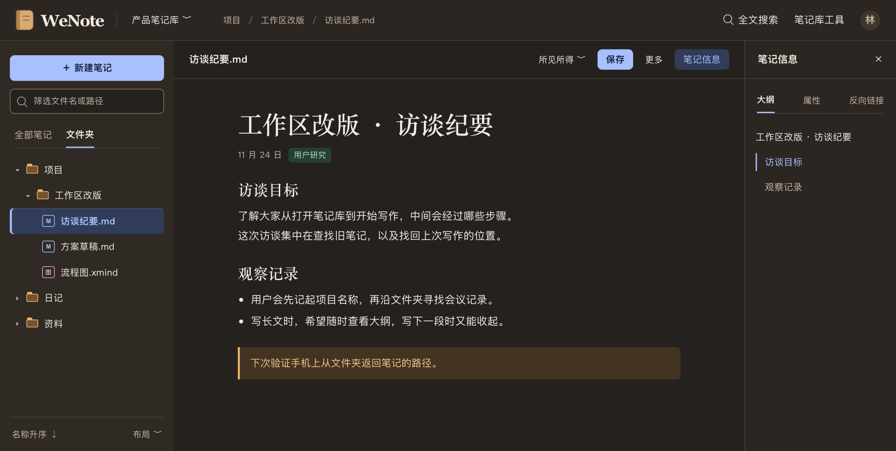

# WeNote 笔记工作区设计

**Mantine AppShell · 产品与交互评审稿 · 2026 年 11 月 24 日**

建议桌面默认显示**文件导航和当前笔记**。找文件时，左侧可在「全部笔记」与「文件夹」之间切换。写长文时，点「笔记信息」查看大纲、属性或反向链接。手机每次显示一个主要任务，用户从列表打开正文，返回时回到刚才选中的那一行。

本稿以本地 `main` 的 `722fae3` 为现状基线。三张图展示本轮拟议的日间、手机和夜间界面，图中文字为示例笔记。默认布局、断点和面板尺寸是本轮评审建议值。

## 1. 桌面上写一篇笔记

*图 1 · 用户从「项目 / 工作区改版」打开访谈纪要，正在编辑，并主动展开了右侧大纲。首次进入时右栏收起，正文获得更多空间。*

| 区域 | 用户在这里做什么 | 交互细节 |
| --- | --- | --- |
| 顶部工作区栏 | 确认当前笔记库，查看路径，进入全文搜索或库工具 | Web 的库名可以打开切库菜单。桌面本地库显示当前绑定信息，换库通过「返回同步」完成。面包屑点击父目录时只定位左栏，当前文档继续打开。 |
| 左侧文件导航 | 在当前文件夹新建笔记、沿树找文件、按名字找一篇旧笔记 | 「全部笔记」给出平铺列表，同名文件显示父路径。「文件夹」展开目录并显示文件，点目录名称定位新建位置，点箭头只改变展开状态。列表与树复用同一套条目操作。 |
| 文档标题栏 | 确认文件名、查看编辑模式、保存、打开笔记信息 | 文件名保留扩展名。宽度不足先收纳分享和次要命令，再收缩面包屑。保存或编辑器自己的保存入口始终可达。 |
| 正文 | 读写 Markdown、查看文本，或操作 JSON、XMind | 阅读和所见所得正文居中。源码、分屏、XMind 画布使用可用宽度。标题栏固定在文档区域顶部，正文与左右栏各自滚动。 |
| 右侧笔记信息 | 跳到标题、读 YAML 属性与标签、查看引用当前笔记的文件 | 默认先看大纲。点标题跳到正文对应位置，宽屏保留面板供连续定位。点反向链接相当于打开另一篇笔记，执行切换文档的草稿检查。 |

**保留整理文件时的三栏。** 在「布局」里提供「导航与正文」「目录、列表与正文」和「专注写作」。第二项让频繁移动文件的人同时看到目录树和当前目录的文件，沿用原来的工作习惯。这种布局的大纲以浮层打开，避免四个固定栏争夺空间。专注模式提供常驻的「退出专注」按钮，退出后恢复进入前的排列。

## 2. 手机上从列表写到正文

*图 2 · 左起为列表、编辑和大纲。编辑时隐藏列表底部导航。「更多 → 笔记信息」从底部打开，选中标题后关闭并定位正文。*

1. **进入笔记库。** 显示「笔记 / 新建 / 文件夹」。点「笔记」看全部文件，点「文件夹」逐级浏览，点「新建」沿用当前目录及现有新建、导入菜单。浏览器手机视图也采用这条路径。系统分享、系统返回等动作由 Android 端提供。
2. **进入正文。** 点击列表项后保留列表的目录、筛选、排序和滚动位置。标题栏只留返回、文件名、当前主动作和更多。Android 的系统分享入口移到更多菜单。文件名较长时截断显示，在笔记信息里可读完整路径。
3. **开始和结束编辑。** 阅读态点「编辑」进入该笔记对应模式。编辑态点「完成」，有修改时先保存，成功后回到阅读态。保存失败仍停在编辑态，正文和光标保留。JSON 与 XMind 使用插件提供的操作。打开软键盘后允许最后一行滚到键盘上方。
4. **返回。** 用户只返回列表时，当前编辑会话仍在。再点同一篇即恢复编辑位置。只有即将替换会话、退出库或执行会丢弃草稿的操作时，才显示离开确认。Android 系统返回先收起已打开的输入法，再逐级关闭最上层的弹层或子菜单。从正文回到列表，从工具详情回到工具入口。列表内优先清除筛选，再回到父目录，最后回同步首页。每次只处理一层。

## 3. 哪些功能从哪里进

同一个词代表同一种操作。「筛选文件名或路径」在当前库的文件清单里即时匹配。「全文搜索」进入原有搜索页，可按正文、标签和路径查找。用户拿着一句原文时可以直接用全文搜索，记得文件名时可以留在编辑界面。

| 功能 | Web 工作区 | 桌面和 Android 本地工作区 |
| --- | --- | --- |
| 库与账户 | 顶栏库菜单切换、新建。账户菜单切主题、退出 | 显示绑定库。工具菜单返回同步首页管理目录、账户和同步。Android 底栏用于浏览、创建文件 |
| 笔记与目录 | 左栏新建、上传，条目「更多」管理文件或目录 | 左栏或手机列表提供新建、导入、刷新。右键、行尾更多、触屏长按进入同一组适用操作 |
| 搜索、附件、导出 | 全文搜索有直接入口。附件与整库导出在库工具 | 相同导航名称，复用本地客户端的资源接口。联网获取的结果显示请求状态。离线时可继续按本地文件路径筛选 |
| 分享与收件 | 文档更多可分享快照。库工具含收件箱、已发送和分享管理。审计日志在账户菜单 | Android 文本笔记更多菜单可调起系统分享。桌面、本地插件按当前已接入的能力展示操作 |
| 历史与恢复 | 文档更多打开历史版本，库工具进入回收站。历史阅读页保留返回当前文档入口 | 文件编辑器显示本地保存结果，通过「返回同步」进入同步详情和现有冲突处理流程 |
| 插件与加密库 | 库工具可进入插件管理和加密笔记库 | 本地工作区可进入插件管理，加密库沿用同步首页的独立入口和锁定流程 |
| 外部入口 | 公开分享链接直接进入现有访问、解锁、下载或导入页面。登录页保留独立入口 | 启动先进入现有同步或离线打开流程，打开本地库后才出现工作区 |

**作用范围直接写在操作名里。** 单篇 Markdown 的「导出 XMind」在文档菜单，整库的「导出笔记库」在库工具，删除文件在对应条目的菜单。文件夹行与空白区继续支持创建文件、创建子目录和已有上传操作。删除目录时确认框显示完整目标路径。

## 4. 不同屏宽如何排列

以下宽度均为布局视口的 CSS 像素。浏览器缩放和桌面窗口调整都按实际可用宽度判断。Android 沿用当前对短横屏的特殊判断。

| 可用宽度 | 导航 | 笔记信息与正文 |
| --- | --- | --- |
| ≥ 1280 | 默认左栏 276，可选经典三栏，目录与列表合计约 480 | 默认双栏布局可打开约 248 的固定右栏。专注或经典三栏时用浮层 |
| 1024–1279 | 左栏 248，支持收起 | 大纲从右侧浮出。若此前选择经典三栏，临时使用合并导航。放宽窗口后恢复偏好 |
| 721–1023 | 顶栏「文件」打开导航抽屉，选中文件后关闭 | 主区占满宽度。笔记信息用右侧抽屉，左右抽屉互斥 |
| ≤ 720。Android 横屏宽 ≤ 960 且高 ≤ 540 | 列表、正文、工具页逐屏浏览 | 笔记信息用底部面板。短横屏面板可滚动，关闭按钮保持可见 |

- 桌面顶栏建议 52 高，内边距以 8 的倍数组织。阅读正文最大宽度建议 740，平板左右各留 24，手机各留 16。宽表格和代码块在自身区域横向滚动。系统安全区计入手机顶栏、底栏与底部面板的留白。
- 布局随宽度变化时保持同一个编辑器实例、选区、撤销记录和草稿。窄屏只临时折叠面板。旋转设备不得覆盖桌面布局偏好。手机横屏判定应使用稳定视口，输入法弹出时仍留在当前编辑会话。
- 普通库首次打开时沿用各端选文逻辑。网页加载该库现有笔记，本地端从可浏览的列表开始。空库只给一个主动作，Web 显示「新建笔记」并提供上传，本地库提供导入。账户没有普通库时，Web 首屏主动作是「创建笔记库」。

## 5. 文档、草稿与保存

| 类型或情境 | 标题栏与主体 | 笔记信息或反馈 |
| --- | --- | --- |
| Markdown | 保留预览、所见所得、源码、分屏、思维导图，以及用户设置的默认和记忆模式。分屏内部分隔条继续控制源码与预览比例 | 大纲取当前编辑缓冲区，属性从 frontmatter 提取，可查看标签。反向链接按当前文件查询 |
| TXT | 预览、源码、保存 | 显示完整路径和可用反向链接 |
| JSON、XMind 与本地安装的文件插件 | 宿主打开文件，插件控制格式校验、画布、内容保存及专用导出。XMind 画布可以占满中央区域 | 只展示宿主或插件实际提供的信息。插件禁用或加载失败时沿用现有提示和恢复入口 |
| 历史版本 | Web 从当前文件进入历史页，文本可预览，适用的二进制版本下载 | 显示所看版本和「返回当前文档」。历史查看与当前草稿分开，返回后恢复草稿 |
| 加密笔记库 | 进入独立解锁、编辑、保存与锁定流程 | 普通文件树、路径筛选、最近使用的布局数据均不得写入加密库的明文名称、路径或内容。锁定后清理界面引用并返回入口 |

**保存文案由持久化位置决定。** 网页端在服务端确认后显示「已保存新版本」。桌面与 Android 在本地写盘成功后显示「已保存到本地」。同步状态取同步模块已有的报告，只有取得真实结果才展示时间或失败原因。断网的本地写作流程始终允许保存。全文搜索、导出任务或远程反向链接无法联网时显示「连接后重试」，保留返回正文的入口。

| 用户操作或结果 | 界面规则 |
| --- | --- |
| 未修改 → 修改 → 保存 | 有改动时「保存」可用，提交期间显示「正在保存」并防止重复提交。返回结果只确认本次提交的内容。若期间出现新改动，继续显示「有未保存的修改」 |
| 折叠侧栏、打开信息、切主题、手机返回列表 | 仅改变显示位置，不写盘。再次进入正文时保留文本、撤销历史、选区与滚动位置 |
| 打开另一篇、切库、离开会话或进入会替换它的工具页 | 有草稿时显示文件名与「留在此处」「放弃并继续」。有可调用保存动作的编辑器才提供「保存并继续」，写入成功后执行原动作。浏览器刷新沿用系统离开提示 |
| 网络失败、版本已变化、本地文件已变化 | 保留草稿并展示当前文件与具体原因。暂时断网可重试。基线冲突提供复制草稿或保全副本的路径，再交由现有版本或同步流程处理。旧基线禁止静默覆盖 |
| 正在上传附件或请求反向链接时切换文件 | 结果按库和文件身份核对。旧文档的链接、错误或插入位置只属于原文档。迟到响应不能覆盖新文档或清除它的修改状态 |

## 6. 视觉、键盘与触屏

### 写作区的暖色主题

有道云笔记 Mac 版的官方展示图把蓝色「新建」按钮放在文件列表上方，并用浅蓝色标出当前文件。展开菜单时，正文仍有独立的浅色背景。WeNote 借用这种区分动作、位置和内容的方式。针对初稿偏冷的问题，我们把占屏面积最大的颜色改为暖白和暖杏，给文件夹加上琥珀色轮廓。以下色值是 WeNote 的设计选择。[有道云笔记官方展示图（Mac App Store）](https://apps.apple.com/cn/app/id1600668116)

| 用途 | 日间 | 夜间 | 放在界面哪里 |
| --- | --- | --- | --- |
| 纸面与正文 | 暖白 `#FFFCF7`、炭黑 `#322E29` | 深褐 `#25211E`、米白 `#F3EAE1` | 正文保持整片纸面。中文标题用宋体，界面标签用系统无衬线，源码用等宽字体 |
| 文件导航与工具面板 | 暖杏 `#F5EBDD`、浅米 `#FBF6EE` | 棕灰 `#302A25`、深棕 `#2B2622` | 左栏颜色略重，右侧大纲、手机顶栏和底部面板用较轻的表面色 |
| 次要文字与分隔线 | `#6D6054`、`#E4D8C8` | `#C5B5A5`、`#4B4037` | 路径、日期、排序说明使用次要文字，分隔线用于组织区域 |
| 主操作与按钮文字 | 蓝 `#355DC7`、白 `#FFFFFF` | 浅蓝 `#A8C0FF`、深蓝黑 `#182443` | 新建、可用的保存按钮。手机正文里「完成」只用蓝色文字 |
| 当前选中项 | 淡蓝底 `#E6EDFF`、蓝字 `#355DC7` | 靛灰底 `#313C58`、浅蓝字 `#A8C0FF` | 当前文件同时使用底色、左侧短线和字重。大纲仅标记当前标题 |
| 文件夹、引用与标签 | 文件夹边 `#A76016`，引文底 `#FAECCD`、字 `#744410`，标签底 `#E7EFE8`、字 `#365E46` | 文件夹边 `#EDB86B`，引文底 `#433421`、字 `#F1C98C`，标签底 `#263F33`、字 `#B0D5BC` | 色彩集中于小图标、真实的 Markdown 引用和已有标签。空白笔记只显示标题与正文输入区 |

*图 3 · 与图 1 的笔记和布局相同。夜间保留文件夹的琥珀色，用浅蓝按钮配深色文字。*

**交互状态。** 鼠标悬停文件行时铺一层浅暖色，键盘焦点用 2 像素主色描边并留 2 像素间距。保存成功后按钮退为次要文字，显示「已保存到本地」或「已保存新版本」。失败提示用错误图标、原因和可执行的恢复动作。手机沿用相同颜色，底部操作栏取导航色，正文返回与更多菜单保持足够的触控面积。

**接入方式。** 在 `MantineProvider` 下按浅深模式定义纸面、导航、面板、主文字、次文字、主操作和选中底色。将现有 `--paper`、`--rail`、`--ink`、`--muted`、`--accent`、`--tint` 映射到对应角色。Drawer 和菜单通过 Portal 也应获得同组值。CodeMirror 的底色跟随纸面，选区跟随选中底色。Mermaid 和 XMind 的默认主题随外观切换，并尊重用户已选的脑图主题。

**可读性验收。** 按表中 sRGB 色值计算，正文与纸面的对比度为日间 13.17∶1、夜间 13.44∶1。主按钮文字为 5.93∶1、8.49∶1，选中文件名为 5.06∶1、6.07∶1。实施时还需在实际 WebView 中检查输入焦点、代码高亮、错误提示与系统字体放大后的效果。

### 键盘与触屏

- `Ctrl/⌘ + Shift + F` 延续现有行为，展开文件导航并聚焦路径筛选。`Ctrl/⌘ + S` 调用当前文档的保存。中文输入法正在组词时，Enter、方向键等交给输入控件。树节点与列表项都支持键盘到达、选择与展开。
- 移动端行尾更多、返回、完成和底栏按钮至少提供 48 × 48 的触控区域。纵向拖动只滚列表，长按静止行才打开菜单。子菜单返回上一级，关闭后键盘焦点回到触发按钮。如果该行已删除，移到相邻行。
- 用语义化导航、主区、标题和带名称的按钮支持读屏。面板按钮报告展开状态，当前页和当前文件可由读屏辨认。保存状态在发生变化时播报一次。错误保持可见并提供恢复动作。
- 打开抽屉后焦点进入抽屉，关闭后回到触发位置。点击大纲标题属于正文定位动作，关闭抽屉后将焦点交给目标标题或编辑器。系统偏好减少动画时关闭滑入过渡。

## 7. Mantine 如何接入现有代码

`AppShell` 负责固定面板和主区的空间分配。Web 与本地客户端各自持有笔记会话和读写方法，将同一套导航与显示区域挂在各自入口。现有文件操作、权限及版本校验继续在原来的实现执行。[Mantine AppShell 文档](https://mantine.dev/core/app-shell/)

| 代码位置 | 拟议改动 | 必须保留的行为 |
| --- | --- | --- |
| [Web 入口](../apps/web/src/main.tsx)、[本地编辑入口](../apps/web/src/desktop.tsx) | 在普通工作区入口放 `MantineProvider` 与共享工作区组件。分别传入库、当前文档、工具与可用动作。Web 以库和文件 ID、本地以绑定库和路径识别会话 | Web 的版本基线、Tauri 的本地哈希、二进制插件读写及原有退出确认各有归属。公开分享和本地同步首页有独立入口 |
| [库面板](../apps/web/src/LibraryUI.tsx)、[条目菜单](../apps/web/src/EntryMenu.tsx) | `AppShell.Header` 放库级动作，`Navbar` 放文件浏览，`AppShell.Section` 管理可滚动区域。先抽出已有排序、路径筛选与文件操作，再把树和列表接入新布局 | 保留空目录标记、自然排序、同名文件的完整路径、文件夹上下文菜单、键盘和长按行为 |
| [Web 文档](../apps/web/src/Editor.tsx)、[共享文档](../apps/web/src/markdown/Markdown.tsx)、[插件编辑器](../apps/web/src/plugins/PluginEditor.tsx) | `AppShell.Main` 作为唯一主区。正文保持稳定挂载。宽屏把信息挂到 `AppShell.Aside`，窄屏切换到 `Drawer`。扩展已有 `metadataHost`，把目录和属性显示在选中页签 | 使用同一份 Markdown 解析结果。信息收起时停掉仅为该面板进行的查询，切换面板类型只移动信息视图。插件自己维护撤销与保存 |
| [手机交互](../apps/web/src/PhoneUI.tsx) | 保留现有手机列表与正文层级。新增 Mantine 抽屉时向 Android 返回处理注册当前最上层关闭动作 | 现有处理通过 `dialog[open]` 找原生对话框。Mantine Portal 需显式接入同一返回顺序，避免一次返回同时关弹层并离开正文 |
| [主题](../apps/web/src/appearance.ts)、[现有样式](../apps/web/src/style.css) | 让 Provider 用现有 `wenote-color-scheme-v1` 驱动颜色，更新原有根节点属性及 Mantine 主题。CSS 加载优先级显式约定，将旧全局 `button`、`main`、布局规则逐步收窄 | 检查冷启动主题、深浅切换、弹层 Portal、图表和打印。打印或导出 PDF 时只保留笔记内容 |

**布局实现约定。** `AppShell.Main` 只计算一次固定区域的偏移。经典三栏用一个较宽的 `Navbar` 容纳目录与列表，`Aside` 留给笔记信息。当 Navbar 收起时，顶栏库名前出现带「打开文件导航」名称的按钮。抽屉模式让对应固定面板折叠，避免留下空白偏移。手机正文只保留一个标题栏。使用 `@mantine/core` 与 `@mantine/hooks` 的匹配版本，实施时验证项目的 React 19、Vite 和 Tauri WebView 构建并锁定依赖。[AppShell 布局](https://mantine.dev/core/app-shell/) · [Drawer 焦点与关闭行为](https://mantine.dev/core/drawer/) · [Vite 接入](https://mantine.dev/guides/vite/)

**状态归属。** 布局模式与主题按设备记忆。文件夹、搜索词、树展开和列表滚动按当前库的会话保存。抽屉、子菜单、焦点和正在组词的输入属于当前窗口。编辑器独占草稿、保存基线、选择区与撤销栈。点选导航先检查能否离开，再提交新的选中状态。客户端只呈现该平台提供的动作，离线和权限错误由具体操作反馈。[主题方案](https://mantine.dev/theming/color-schemes/) · [样式加载](https://mantine.dev/styles/mantine-styles/)

## 8. 实施顺序与验收

| 阶段 | 可交付的完整体验 | 进入下一阶段的条件 |
| --- | --- | --- |
| 一 · Web 读写 | 普通库中完成查找、打开、编辑、保存。新壳层接入标题栏、文件导航、主题和可选笔记信息 | 同一篇 Markdown 切栏后仍能撤销，保存生成正确版本。关闭信息面板后正文获得可用宽度 |
| 二 · Web 工具与文件类型 | 接入库工具、经典三栏、历史、插件、附件和导出。验证公开分享与加密入口 | 在界面上找得到原有各项动作，按路径定位同名文件正确，插件修改可保存，打印只含正文 |
| 三 · 桌面本地工作区 | 复用壳层，接入本地打开、写入、离线浏览和返回同步 | 断网修改可落盘，重开本地库可读。恢复联网后可通过原同步流程查到结果 |
| 四 · 手机与跨端回归 | 小屏 Web 和 Android 接入逐屏导航、底部信息面板和返回栈 | 竖屏、短横屏、软键盘、读屏焦点、触屏长按和系统返回均通过场景验收 |

### 可直接执行的场景

| 场景 | 操作 | 通过条件 |
| --- | --- | --- |
| 同名与筛选 | 在两个文件夹创建同名笔记，按路径筛选，打开其中一篇，再清除筛选 | 结果显示父路径，正文属于选中项，清除筛选后目录上下文可恢复 |
| 长文写作 | 在文中改一个词，打开大纲、切换主题、收起左栏、恢复布局，再撤销 | 草稿连续，撤销一次还原刚才的词。面板开合不触发保存 |
| 草稿跨页 | 编辑 Markdown 或改动 XMind 节点后，选另一篇、切库或进入会替换文档的工具页 | 取消后文件、选区和内容仍在。选择保存并继续时，只有写入成功才导航 |
| 离线与冲突 | 断开桌面网络，保存本地文档并打开全文搜索。在 Web 用两个会话修改同一版本 | 本地显示已写盘，搜索显示可重试。Web 旧基线写入失败时保住草稿，未显示成功 |
| 窗口变化 | 带着未保存修改调整到 1440、1280、1024、768、390 像素宽，再旋转到 844 × 390 | 固定栏和抽屉依表切换，右栏无残留空位，正文仍可输入，扩大后恢复布局 |
| 手机上下文 | 在已筛选的长列表打开文件，输入中文，打开大纲，选标题，再按系统返回 | 输入完整，标题定位正确，返回列表恢复筛选和滚动位置。独立测试在子菜单按返回只退一级 |
| 格式和设备 | 轮流打开 TXT、Markdown、JSON、XMind，执行各自的保存或导出，并在另一设备同步后打开 | 模式与动作符合文件类型，JSON 可再次解析，XMind 可再次打开并保留修改，Android 导出进入系统保存流程 |
| 独立入口 | 直接打开受密码保护的分享链接。解锁加密库、编辑、锁定，然后回普通库 | 访问按原权限校验。锁定后在普通导航、最近使用数据与屏幕上均找不到明文信息 |

实施阶段可扩展现有 [条目菜单测试](../apps/web/tests/entry-menu.mjs)、[外观回归](../apps/web/tests/theme.mjs)、[Android 场景](../apps/web/tests/android.mjs)和[桌面端到端验收](../tests/e2e/desktop.mjs)。两端构建入口见[项目说明](../README.md)。以上为后续实现验收标准，本轮已交付的内容是设计稿及三张示意图。

**本轮主题评审可对照图 1 和图 3。** 两图展示同一篇笔记，便于观察日夜两种模式下正文、当前文件和保存动作的层次。图 2 用于检查这些颜色在手机上的实际占比。
