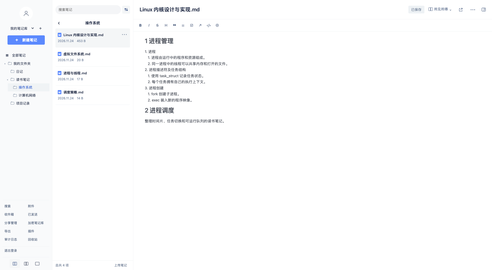
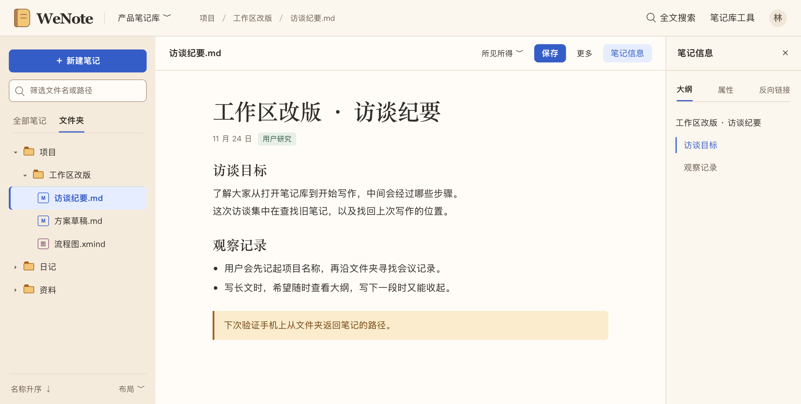
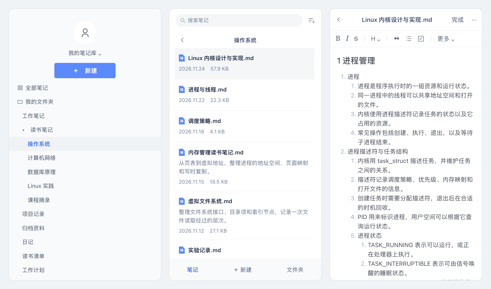

# WeNote 笔记工作区设计

**Mantine AppShell · 产品与交互评审稿 · 2026 年 11 月 24 日**

桌面以用户提供的有道云笔记截图为视觉基准。打开文件夹时，左栏停在该目录，中栏列出笔记，点选后在右栏读写。三栏从窗口顶部开始，各有自己的操作区。整个工作区共用一套白、浅灰和蓝色，常用字号为 12–14 px。

**实现预览**　下图取自 1900 × 1046 的 Web 验收版，使用示例笔记库。打开「读书笔记 → 操作系统 → Linux 内核设计与实现.md」即可对照实际字号、选中状态和正文间距。下文保留各端的设计规格。[本轮验收记录](tasks/FEAT-20261124-note-workspace.md)

## 1. 桌面三栏工作区

*图 1 · 1900 × 1046，与参考截图同尺寸。当前目录为「读书笔记 / 操作系统」，中栏选中第一篇，右栏展开 Markdown 笔记。文件名、笔记内容和元数据为示例。*

| 区域 | 尺寸与位置 | 使用方式 |
| --- | --- | --- |
| 库与目录 | 左侧 202 px，整栏浅灰。顶部放头像、库名与蓝色「＋ 新建」，底部放布局切换 | 点「全部笔记」列出当前库文件，选择目录刷新中栏，点展开箭头只展开下一级。高亮当前目录。新建以所选目录为目标，库工具按平台能力提供分享、回收站或返回同步 |
| 笔记列表 | 中间 313 px，白底。顶部搜索框与排序，下方为返回上级按钮和当前文件夹名，底部显示结果数 | 一行显示小文件图标与文件名，次行显示可取得的日期和大小。有现成摘要或缩略图时最多显示两行摘要和一张小图。没有这些数据时使用紧凑行。选中文件用浅灰底 |
| 文件标题栏 | 从 x = 515 起，只占右栏。高 75 px。文件名左对齐，保存、信息、分享和更多靠右 | 编辑动作由当前文件类型决定。「保存」采用浅灰按钮，明确显示加载、已保存或重试状态。文件名过长时截断，完整路径通过提示或笔记信息查看 |
| 格式工具栏 | 标题栏下方 47 px，按钮在一条横线上，相关命令用细线分组 | Markdown 编辑时提供加粗、斜体、删除线、标题、引用、列表、链接、附件和代码。窄窗口把末尾命令收进「更多」。TXT 和文件插件各用自己的工具 |
| 正文 | 从 y = 122 起，左侧内边距 44 px，内容使用右栏可用宽度，正文与左右栏分别滚动 | 标题和列表左对齐，保留 Markdown 层级缩进。正文左边缘的小按钮按需打开大纲浮层，点标题后定位到该段。属性和反向链接从标题栏的「笔记信息」进入 |

底部三个布局按钮依次用于三栏、列表与正文、专注写作，默认选中三栏。折叠时保留已展开目录、当前文件和滚动位置。用户退出专注后回到之前的排列。

## 2. 手机上从列表写到正文

*图 2 · 左起为目录、列表与编辑。三屏使用同一套颜色，编辑时隐藏列表底部导航。「更多 → 笔记信息」从底部打开，选中标题后关闭并定位正文。*

1. **进入笔记库。** 显示「笔记 / 新建 / 文件夹」。点「笔记」看全部文件，点「文件夹」逐级浏览，点「新建」沿用当前目录及现有新建、导入菜单。浏览器手机视图也采用这条路径。系统分享、系统返回等动作由 Android 端提供。
2. **进入正文。** 点击列表项后保留列表的目录、筛选、排序和滚动位置。标题栏只留返回、文件名、当前主动作和更多。Android 的系统分享入口移到更多菜单。文件名较长时截断显示，在笔记信息里可读完整路径。
3. **开始和结束编辑。** 阅读态点「编辑」进入该笔记对应模式。编辑态点「完成」，有修改时先保存，成功后回到阅读态。保存失败仍停在编辑态，正文和光标保留。JSON 与 XMind 使用插件提供的操作。打开软键盘后允许最后一行滚到键盘上方。
4. **返回。** 用户只返回列表时，当前编辑会话仍在。再点同一篇即恢复编辑位置。只有即将替换会话、退出库或执行会丢弃草稿的操作时，才显示离开确认。Android 系统返回先收起已打开的输入法，再逐级关闭最上层的弹层或子菜单。从正文回到列表，从工具详情回到工具入口。列表内优先清除筛选，再回到父目录，最后回同步首页。每次只处理一层。

## 3. 哪些功能从哪里进

同一个词代表同一种操作。中栏「搜索笔记」默认在当前库按文件名或路径即时匹配，输入框的无障碍名称为「筛选笔记路径」。搜索框的「全文搜索」动作进入原有搜索页，可按正文、标签和路径查找。用户拿着一句原文时可以直接用全文搜索，记得文件名时可以留在编辑界面。

| 功能 | Web 工作区 | 桌面和 Android 本地工作区 |
| --- | --- | --- |
| 库与账户 | 左栏库名菜单切换或新建库。头像菜单提供账户和退出操作 | 显示绑定库。工具菜单返回同步首页管理目录、账户和同步。Android 底栏用于浏览、创建文件 |
| 笔记与目录 | 左栏新建、上传，条目「更多」管理文件或目录 | 左栏或手机列表提供新建、导入、刷新。右键、行尾更多、触屏长按进入同一组适用操作 |
| 搜索、附件、导出 | 全文搜索有直接入口。附件与整库导出在库工具 | 相同导航名称，复用本地客户端的资源接口。联网获取的结果显示请求状态。离线时可继续按本地文件路径筛选 |
| 分享与收件 | 文档更多可分享快照。库工具含收件箱、已发送和分享管理。审计日志在账户菜单 | Android 文本笔记更多菜单可调起系统分享。桌面、本地插件按当前已接入的能力展示操作 |
| 历史与恢复 | 文档更多打开历史版本，库工具进入回收站。历史阅读页保留返回当前文档入口 | 文件编辑器显示本地保存结果，通过「返回同步」进入同步详情和现有冲突处理流程 |
| 插件与加密库 | 库工具可进入插件管理和加密笔记库 | 本地工作区可进入插件管理，加密库沿用同步首页的独立入口和锁定流程 |
| 外部入口 | 公开分享链接直接进入现有访问、解锁、下载或导入页面。登录页保留独立入口 | 启动先进入现有同步或离线打开流程，打开本地库后才出现工作区 |

**作用范围直接写在操作名里。** 单篇 Markdown 的「导出 XMind」在文档菜单，整库的「导出笔记库」在库工具，删除文件在对应条目的菜单。文件夹行与空白区继续支持创建文件、创建子目录和已有上传操作。删除目录时确认框显示完整目标路径。

## 4. 不同屏宽如何排列

以下宽度均为布局视口的 CSS 像素。浏览器缩放和桌面窗口调整都按实际可用宽度判断。Android 沿用当前对短横屏的特殊判断。

| 可用宽度 | 导航 | 笔记信息与正文 |
| --- | --- | --- |
| ≥ 1280 | 目录 202 px，列表 313 px，正文占余宽 | 大纲和笔记信息按需浮出。布局切换位于左栏底部 |
| 1024–1279 | 目录 176 px，列表 256 px | 正文左右各留 24 px，优先将次要命令收入「更多」 |
| 721–1023 | 默认保留 240 px 列表和正文，列表顶部的目录按钮打开目录抽屉 | 选目录后更新列表，点文件后更新正文。单次只展开一个抽屉 |
| ≤ 720，或 Android 横屏宽 ≤ 960 且高 ≤ 540 | 目录、列表、正文逐屏切换 | 手机正文保留 16 px 左右内边距，笔记信息从底部打开 |

- 右侧正文随窗口宽度自然换行。长代码块、宽表格在块内滚动。触屏留出系统安全区，手机键盘出现后仍能编辑最后一行。
- 布局随宽度变化时保持同一个编辑器实例、选区、撤销记录和草稿。窄屏只临时折叠面板。旋转设备不得覆盖桌面布局偏好。手机横屏判定应使用稳定视口，输入法弹出时仍留在当前编辑会话。
- 普通库首次打开时沿用各端选文逻辑。网页加载该库现有笔记，本地端从可浏览的列表开始。空库只给一个主动作，Web 显示「新建笔记」并提供上传，本地库提供导入。账户没有普通库时，Web 首屏主动作是「创建笔记库」。

## 5. 文档、草稿与保存

| 类型或情境 | 标题栏与主体 | 笔记信息或反馈 |
| --- | --- | --- |
| Markdown | 保留预览、所见所得、源码、分屏、思维导图，以及用户设置的默认和记忆模式。分屏内部分隔条继续控制源码与预览比例 | 大纲取当前编辑缓冲区，属性从 frontmatter 提取，可查看标签。反向链接按当前文件查询 |
| TXT | 预览、源码、保存 | 显示完整路径和可用反向链接 |
| JSON、XMind 与本地安装的文件插件 | 宿主打开文件，插件控制格式校验、画布、内容保存及专用导出。XMind 画布可以占满右侧编辑区 | 只展示宿主或插件实际提供的信息。插件禁用或加载失败时沿用现有提示和恢复入口 |
| 历史版本 | Web 从当前文件进入历史页，文本可预览，适用的二进制版本下载 | 显示所看版本和「返回当前文档」。历史查看与当前草稿分开，返回后恢复草稿 |
| 加密笔记库 | 进入独立解锁、编辑、保存与锁定流程 | 普通文件树、路径筛选、最近使用的布局数据均不得写入加密库的明文名称、路径或内容。锁定后清理界面引用并返回入口 |

**保存文案由持久化位置决定。** 网页端在服务端确认后显示「已保存新版本」。桌面与 Android 在本地写盘成功后显示「已保存到本地」。同步状态取同步模块已有的报告，只有取得真实结果才展示时间或失败原因。断网的本地写作流程始终允许保存。全文搜索、导出任务或远程反向链接无法联网时显示「连接后重试」，保留返回正文的入口。

| 用户操作或结果 | 界面规则 |
| --- | --- |
| 未修改 → 修改 → 保存 | 有改动时「保存」可用，提交期间显示「正在保存」并防止重复提交。返回结果只确认本次提交的内容。若期间出现新改动，继续显示「有未保存的修改」 |
| 折叠侧栏、打开信息、切换目录、手机返回列表 | 仅改变显示位置，不写盘。再次进入正文时保留文本、撤销历史、选区与滚动位置 |
| 打开另一篇、切库、离开会话或进入会替换它的工具页 | 有草稿时显示文件名与「留在此处」「放弃并继续」。有可调用保存动作的编辑器才提供「保存并继续」，写入成功后执行原动作。浏览器刷新沿用系统离开提示 |
| 网络失败、版本已变化、本地文件已变化 | 保留草稿并展示当前文件与具体原因。暂时断网可重试。基线冲突提供复制草稿或保全副本的路径，再交由现有版本或同步流程处理。旧基线禁止静默覆盖 |
| 正在上传附件或请求反向链接时切换文件 | 结果按库和文件身份核对。旧文档的链接、错误或插入位置只属于原文档。迟到响应不能覆盖新文档或清除它的修改状态 |

## 6. 视觉、键盘与触屏

### 截图配色与文字尺寸

以下表面与正文色值取自用户截图的纯色区域。字号与间距以截图的视觉比例拟定，单位为 CSS px。按原尺寸查看图 1，可直接对照同一行文字占用的空间。

| 元素 | 色值 | 规则 |
| --- | --- | --- |
| 列表与正文 | `#FFFFFF` | 两栏使用同一白底，边缘用 1 px 细线分隔 |
| 目录栏、选中目录 | `#F9FAFB`、`#F0F3F5` | 当前目录用蓝字标记；展开态用独立箭头表示 |
| 当前笔记、搜索框 | `#F4F6F7` | 选中笔记使用浅灰底，文件名使用深色半粗体 |
| 新建按钮 | `#5B89FE` | 白字，圆角 4 px。保存、更多和格式工具用中性灰，键盘焦点另有细描边 |
| 文件名、正文 | `#232D47`、`#494E58` | 系统无衬线字体，macOS 优先使用苹方，Windows 使用微软雅黑。固定宽度字符仅用于代码 |
| 辅助文字 | 截图样本 `#A9B2C2`，样稿 `#71809A` | 日期、大小和搜索提示适度加深，避免小字在白底上过淡 |

| 文字层级 | 桌面字号 / 行高 | 使用位置 |
| --- | --- | --- |
| 辅助文字 | 12 / 18 px | 日期、大小、列表底部计数 |
| 文件导航、笔记名 | 13 / 20 px | 目录行高 30 px。普通笔记行约 74 px，摘要行按内容增加高度 |
| 正文 | 14 / 23.5 px | 普通段落、列表、表格。手机正文 14 / 22 px，允许系统放大 |
| 文件标题 | 20 / 30 px | 右栏文件名。手机文件名 14 px |
| Markdown 一级标题 | 24 / 34 px | 二级标题建议 20 px，三级 16 px。手机一级标题 19 px |

普通笔记工作区固定这一套浅色外观。头像菜单只提供账户相关操作。AppShell、弹层、编辑器纸面、列表和默认图表背景共用相同色值。系统字体缩放和键盘焦点仍然生效。

### 键盘与触屏

- `Ctrl/⌘ + Shift + F` 延续现有行为，展开笔记列表并聚焦中栏搜索框。`Ctrl/⌘ + S` 调用当前文档的保存。中文输入法正在组词时，Enter、方向键等交给输入控件。树节点与列表项都支持键盘到达、选择与展开。
- 移动端行尾更多、返回、完成和底栏按钮至少提供 48 × 48 的触控区域。纵向拖动只滚列表，长按静止行才打开菜单。子菜单返回上一级，关闭后键盘焦点回到触发按钮。如果该行已删除，移到相邻行。
- 用语义化导航、主区、标题和带名称的按钮支持读屏。面板按钮报告展开状态，当前页和当前文件可由读屏辨认。保存状态在发生变化时播报一次。错误保持可见并提供恢复动作。
- 打开抽屉后焦点进入抽屉，关闭后回到触发位置。点击大纲标题属于正文定位动作，关闭抽屉后将焦点交给目标标题或编辑器。系统偏好减少动画时关闭滑入过渡。

## 7. Mantine 如何接入现有代码

`AppShell` 负责固定面板和主区的空间分配。Web 与本地客户端各自持有笔记会话和读写方法，将同一套导航与显示区域挂在各自入口。现有文件操作、权限及版本校验继续在原来的实现执行。[Mantine AppShell 文档](https://mantine.dev/core/app-shell/)

| 代码位置 | 拟议改动 | 必须保留的行为 |
| --- | --- | --- |
| [Web 入口](../apps/web/src/main.tsx)、[本地编辑入口](../apps/web/src/desktop.tsx) | 在普通工作区入口放 `MantineProvider` 与共享工作区组件。分别传入库、当前文档、工具与可用动作。Web 以库和文件 ID、本地以绑定库和路径识别会话 | Web 的版本基线、Tauri 的本地哈希、二进制插件读写及原有退出确认各有归属。公开分享和本地同步首页有独立入口 |
| [库面板](../apps/web/src/LibraryUI.tsx)、[条目菜单](../apps/web/src/EntryMenu.tsx) | `AppShell.Navbar` 包含左目录与中列表，两个区域分别滚动。库级动作放左栏，搜索与排序放中栏。先抽出已有排序、路径筛选与文件操作，再把树和列表接入新布局 | 保留空目录标记、自然排序、同名文件的完整路径、文件夹上下文菜单、键盘和长按行为 |
| [Web 文档](../apps/web/src/Editor.tsx)、[共享文档](../apps/web/src/markdown/Markdown.tsx)、[插件编辑器](../apps/web/src/plugins/PluginEditor.tsx) | `AppShell.Main` 作为唯一主区。正文保持稳定挂载。标题栏和格式栏只在右侧主区占位。大纲与信息通过浮层或 `Drawer` 展示。扩展已有 `metadataHost`，把目录和属性显示在选中页签 | 使用同一份 Markdown 解析结果。信息收起时停掉仅为该面板进行的查询，切换面板类型只移动信息视图。插件自己维护撤销与保存 |
| [手机交互](../apps/web/src/PhoneUI.tsx) | 保留现有手机列表与正文层级。新增 Mantine 抽屉时向 Android 返回处理注册当前最上层关闭动作 | 现有处理通过 `dialog[open]` 找原生对话框。Mantine Portal 需显式接入同一返回顺序，避免一次返回同时关弹层并离开正文 |
| [外观入口](../apps/web/src/appearance.ts)、[现有样式](../apps/web/src/style.css) | 在普通工作区的 Provider 固定浅色，将表面、分隔、正文与操作色映射到现有 CSS 变量，Portal 使用同组样式 | 从旧版深色偏好进入工作区时，导航和正文均应按本稿显示。编辑器沿用用户无障碍字号设置。打印或导出 PDF 只保留笔记内容 |

**布局实现约定。** `AppShell.Main` 只计算一次 Navbar 的宽度偏移。宽屏 Navbar 总宽 515 px，内部以 202 px 与余宽分成目录和列表。编辑器保留同一个挂载位置，文档栏独立放置文件标题与工具栏。关闭浮层后焦点回到触发按钮或选中的正文位置。实施时按 React 19、Vite 与 Tauri WebView 的目标环境验证构建。[AppShell 布局](https://mantine.dev/core/app-shell/) · [Drawer 焦点与关闭行为](https://mantine.dev/core/drawer/) · [Vite 接入](https://mantine.dev/guides/vite/)

**状态归属。** 布局模式按设备记忆。文件夹、搜索词、树展开和列表滚动按当前库的会话保存。抽屉、子菜单、焦点和正在组词的输入属于当前窗口。编辑器独占草稿、保存基线、选择区与撤销栈。点选导航先检查能否离开，再提交新的选中状态。客户端只呈现该平台提供的动作，离线和权限错误由具体操作反馈。[样式加载](https://mantine.dev/styles/mantine-styles/)

## 8. 实施顺序与验收

| 阶段 | 可交付的完整体验 | 进入下一阶段的条件 |
| --- | --- | --- |
| 一 · Web 读写 | 普通库中完成查找、打开、编辑、保存。新壳层接入标题栏、目录、笔记列表、格式栏与笔记信息浮层 | 同一篇 Markdown 切栏后仍能撤销，保存生成正确版本。关闭浮层后焦点回到原处 |
| 二 · Web 工具与文件类型 | 接入库工具、布局切换、历史、插件、附件和导出。验证公开分享与加密入口 | 在界面上找得到原有各项动作，按路径定位同名文件正确，插件修改可保存，打印只含正文 |
| 三 · 桌面本地工作区 | 复用三栏工作区，接入本地打开、写入、离线浏览和返回同步 | 断网修改可落盘，重开本地库可读。恢复联网后可通过原同步流程查到结果 |
| 四 · 手机与跨端回归 | 小屏 Web 和 Android 接入逐屏导航、底部信息面板和返回栈 | 竖屏、短横屏、软键盘、读屏焦点、触屏长按和系统返回均通过场景验收 |

### 可直接执行的场景

| 场景 | 操作 | 通过条件 |
| --- | --- | --- |
| 视觉对照 | 以 1900 × 1046、100% 缩放打开普通工作区，并从旧版深色偏好重新进入 | 首屏为浅色三栏，栏界在 x = 202、515，正文从工具栏下方开始。检查 13 px 列表、14 px 正文、20 px 文件名及 24 px 一级标题 |
| 同名与筛选 | 在两个文件夹创建同名笔记，按路径筛选，打开其中一篇，再清除筛选 | 结果显示父路径，正文属于选中项，清除筛选后目录上下文可恢复 |
| 长文写作 | 在文中改一个词，打开大纲、收起左栏、恢复布局，再撤销 | 草稿连续，撤销一次还原刚才的词。面板开合不触发保存 |
| 草稿跨页 | 编辑 Markdown 或改动 XMind 节点后，选另一篇、切库或进入会替换文档的工具页 | 取消后文件、选区和内容仍在。选择保存并继续时，只有写入成功才导航 |
| 离线与冲突 | 断开桌面网络，保存本地文档并打开全文搜索。在 Web 用两个会话修改同一版本 | 本地显示已写盘，搜索显示可重试。Web 旧基线写入失败时保住草稿，未显示成功 |
| 窗口变化 | 带着未保存修改调整到 1440、1280、1024、768、390 像素宽，再旋转到 844 × 390 | 固定栏和抽屉依表切换，右栏无残留空位，正文仍可输入，扩大后恢复布局 |
| 手机上下文 | 在已筛选的长列表打开文件，输入中文，打开大纲，选标题，再按系统返回 | 输入完整，标题定位正确，返回列表恢复筛选和滚动位置。独立测试在子菜单按返回只退一级 |
| 格式和设备 | 轮流打开 TXT、Markdown、JSON、XMind，执行各自的保存或导出，并在另一设备同步后打开 | 模式与动作符合文件类型，JSON 可再次解析，XMind 可再次打开并保留修改，Android 导出进入系统保存流程 |
| 独立入口 | 直接打开受密码保护的分享链接。解锁加密库、编辑、锁定，然后回普通库 | 访问按原权限校验。锁定后在普通导航、最近使用数据与屏幕上均找不到明文信息 |

实施阶段可扩展现有 [条目菜单测试](../apps/web/tests/entry-menu.mjs)、[外观回归](../apps/web/tests/theme.mjs)、[Android 场景](../apps/web/tests/android.mjs)和[桌面端到端验收](../tests/e2e/desktop.mjs)。两端构建入口见[项目说明](../README.md)。以上为后续实现验收标准，本轮交付为设计文档、桌面原尺寸示意图和手机逐屏示意图。
